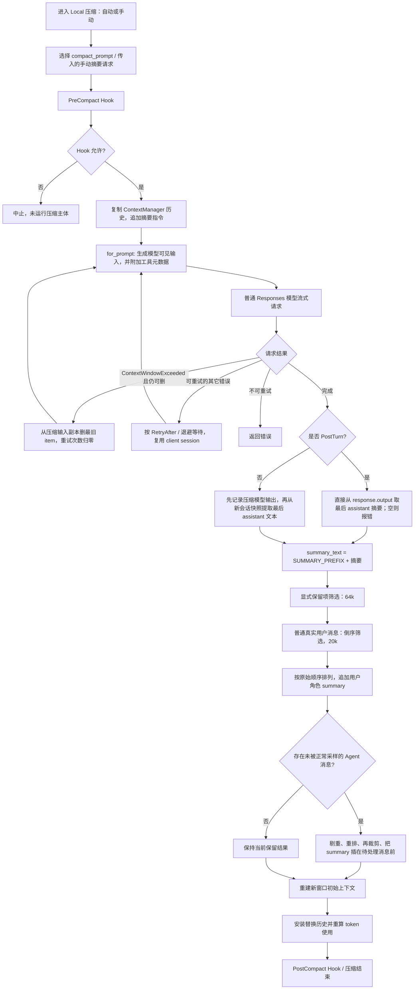

# Codex Local Compaction 源码详解：完整 Pipeline、消息保留策略与 Python 伪代码

> **研究版本**：OpenAI Codex 固定提交 [`e787cf7024fa66e4ec26c6c2ba9c122e045dedb9`](https://github.com/openai/codex/tree/e787cf7024fa66e4ec26c6c2ba9c122e045dedb9)  
> **范围**：只分析 **Local Compaction（普通 LLM 摘要分支）**，包括摘要请求、重试、原始消息选择、待处理 Agent 消息、上下文重建与安装。不展开 Remote V2、TokenBudget、完整 JSONL 恢复；音频只说明其类型/预算关联，不分析专用处理。  
> **核查方式**：直接读取以上固定提交的 Rust 文件和关联单元测试。以下行号均针对该提交，不保证适用于后续 `main`。  
> **伪代码定位**：翻译 Rust 控制流、数据结构和分支，保留关键辅助函数；对未完全展开的 Codex 内部方法使用同名的 `session.*` 等占位调用，并非可独立运行的实现。

## 0. 先给结论：谁决定保留消息？

**不是摘要 LLM 选取，也不是 LLM 给历史打 `important` 标签。**

Codex 的 Local Compaction 划分了两件事：

1. **LLM 做语义压缩**：阅读历史，输出一段关于进度、决策、约束、后续步骤的**文字摘要**。
2. **Harness 做结构化选择**：从原始 `ContextManager` 历史里，按类型、来源元数据、预算、时间顺序选出应原样保留或裁剪后保留的消息。

这两部分在 `run_compact_task_inner_impl()` 里汇合：

```text
原始有效历史
    │
    ├── history 副本 + 摘要指令 ──普通 LLM 请求──> summary_text
    │
    └── history_snapshot ──Harness 规则筛选──> retained_items
                                                   │
                         retained_items + summary ┘
                                      │
                      待处理 Agent 消息位置修正
                                      │
                         重新注入新窗口初始上下文
                                      │
                    replace_compacted_history()
```

**另一个很重要的发现：Local 有两个不同的保留预算。**

| 层次 | 预算 | 对象 | 关键代码 |
|---|---:|---|---|
| 显式跨窗口保留项 | **64,000** 估算 token | `retain_across_windows == Some(true)` 的 `ResponseItemEnvelope`，按保留项选择器处理 | [`compact_remote_v2.rs:604–616`](https://github.com/openai/codex/blob/e787cf7024fa66e4ec26c6c2ba9c122e045dedb9/codex-rs/core/src/compact_remote_v2.rs#L604-L616) |
| 普通真实用户消息 | **20,000** 估算 token | 最近的真实 `UserMessage`；已在上一层选中的同一条消息不重复添加，但会扣本层预算 | [`compact.rs:733–858`](https://github.com/openai/codex/blob/e787cf7024fa66e4ec26c6c2ba9c122e045dedb9/codex-rs/core/src/compact.rs#L733-L858) |

注意：**64k 与 20k 是两个选择阶段的预算，不能简单说最后新历史严格最多 84k token。** 实际还可能有摘要、重建的初始上下文、待处理 Agent 消息、截断标记、估算误差等。64k 的选择器也不会“无条件保住所有显式标记的消息”；遇到不足预算时仍会裁剪或停止。

---

## 1. 全部流程总览（含主要分支）



**源代码主索引**：[`compact.rs:123–265`](https://github.com/openai/codex/blob/e787cf7024fa66e4ec26c6c2ba9c122e045dedb9/codex-rs/core/src/compact.rs#L123-L265)、[`267–477`](https://github.com/openai/codex/blob/e787cf7024fa66e4ec26c6c2ba9c122e045dedb9/codex-rs/core/src/compact.rs#L267-L477)、[`733–858`](https://github.com/openai/codex/blob/e787cf7024fa66e4ec26c6c2ba9c122e045dedb9/codex-rs/core/src/compact.rs#L733-L858)。

### 实际新历史的大致形态

**常见、没有待处理 Agent 消息的 Local 路径**：

```python
replacement_history = [
    *fresh_prefix,             # 重新生成的新窗口前缀
    *selected_original_items,  # 64k 显式保留项 + 20k 普通真实用户消息，按原始顺序
    *fresh_context,            # 插入到选定边界，不一定就在末尾
    summary_user_message,      # role='user'，不是 assistant，也不是 Remote Compaction item
]
```

请注意 `fresh_context` 具体插入点会随历史组成变化，不应把上例当成固定拼接顺序。**有待处理 Agent 消息时，summary 也不一定在最终数组最后。**

---

## 2. 第一步：入口、摘要指令与 Hook

**做什么**：自动压缩与手动压缩最终都进入同一 Local 核心函数；执行前允许 PreCompact Hook 拦截。

**源码**：
- [`compact.rs:123–153`](https://github.com/openai/codex/blob/e787cf7024fa66e4ec26c6c2ba9c122e045dedb9/codex-rs/core/src/compact.rs#L123-L153)：自动 Local，读取 `config.compact_prompt`，缺省使用 `SUMMARIZATION_PROMPT`。
- [`compact.rs:155–177`](https://github.com/openai/codex/blob/e787cf7024fa66e4ec26c6c2ba9c122e045dedb9/codex-rs/core/src/compact.rs#L155-L177)：手动 Local，接收外层传入的 `input`。
- [`compact.rs:179–265`](https://github.com/openai/codex/blob/e787cf7024fa66e4ec26c6c2ba9c122e045dedb9/codex-rs/core/src/compact.rs#L179-L265)：Pre/Post Hook、状态与错误事件、`finish_compaction`。
- [默认摘要模板原文](https://github.com/openai/codex/blob/e787cf7024fa66e4ec26c6c2ba9c122e045dedb9/codex-rs/prompts/templates/compact/prompt.md)（短文件）。

默认模板的内容大意是：生成一份 **handoff summary**，交给接续任务的另一模型。要求写当前进度与关键决策、上下文与约束、剩余步骤，以及继续工作所需的关键数据或示例。

```python
async def run_inline_auto_compact_task(sess, step_ctx, replacement_step_ctx, world_state, reason, phase):
    prompt = step_ctx.turn.config.compact_prompt or SUMMARIZATION_PROMPT
    input_ = [ResolvedUserInput.text(prompt)]
    return await run_compact_task_inner(
        sess, step_ctx, replacement_step_ctx, input_, world_state,
        CompactionTurnMetadata(
            trigger="Auto", reason=reason,
            implementation="Responses", phase=phase,
        ),
    )

async def run_compact_task_inner(sess, step_ctx, replacement_step_ctx,
                                 input_, world_state, meta):
    attempt = await CompactionAnalyticsAttempt.begin(...)
    pre_outcome = await run_pre_compact_hooks(sess, step_ctx.turn, meta.trigger)
    if pre_outcome == "Stopped":
        await attempt.track(status="Interrupted", ...)
        raise TurnAborted()

    try:
        result = await run_compact_task_inner_impl(
            sess, step_ctx, replacement_step_ctx, input_, world_state, meta,
        )
    except Exception as exc:
        result = exc

    # Rust 先根据主体结果决定是否跑 PostCompact Hook；
    # 主体执行成功后调用的 PostCompact Hook 若 Stop，可能发生“已装好检查点但上层收到中止”。
    if not isinstance(result, Exception):
        if await run_post_compact_hooks(sess, step_ctx.turn, meta.trigger) == "Stopped":
            await attempt.track(...)
            raise TurnAborted()
    await attempt.track(...)
    return sess.finish_compaction(step_ctx.turn, meta.phase, result)
```

> **思路**：压缩是 Harness 的一种任务操作，而不是普通用户会话里让 LLM 自行决定“要不要 compact”。Hook 有控制权，但**本文消息筛选规则的主体不由 Hook 或摘要 LLM 决定**。

---

## 3. 第二步：克隆历史，并只向**压缩副本**追加摘要指令

**做什么**：把摘要请求当成最后一条用户输入，交给压缩模型；记住压缩前已有的用户目标 ID。

**源码**：[`compact.rs:267–303`](https://github.com/openai/codex/blob/e787cf7024fa66e4ec26c6c2ba9c122e045dedb9/codex-rs/core/src/compact.rs#L267-L303)。

步骤：

1. 生成 `ContextCompaction` 进度事件；根据阶段决定是现在还是稍后发送开始事件。
2. `ResolvedUserInput::into_message(input, LocalImagePreparation::Process)` 转为模型可见用户消息，允许输入中包含经处理的图片。
3. `history = sess.clone_history()` 得到**有效历史副本**，不是直接从整个 JSONL 原始事件重放。
4. 保存 `input_goal_ids = UserGoalUpdate::message_ids(history.raw_items())`。
5. `history.record_items(...)` 把摘要提示加入副本，应用当前模型截断策略。
6. 准备 `fallback_instructions`：优先找副本中保存的 `BaseInstructionsFragment`；否则使用会话已有的基础指令；若历史声明了工具而基础片段缺失，源码有清空回退文本的分支。

```python
# 对应 run_compact_task_inner_impl() 的准备段
compaction_item = ContextCompactionItem.new()
defer_start = sess.defer_compaction_start(turn_ctx, phase)
if not defer_start:
    await sess.emit_turn_item_started(turn_ctx, compaction_item)

initial_input_for_turn, _ = ResolvedUserInput.into_message(
    input_, local_image_preparation="Process"
)
history = await sess.clone_history()
input_goal_ids = UserGoalUpdate.message_ids(history.raw_items())
history.record_items(
    [ResponseItemEnvelope.new(initial_input_for_turn)],
    truncation_policy=turn_ctx.model_info.truncation_policy,
)

fallback_instructions = await sess.get_prompt_base_instructions()
fragment_text = first_base_instructions_fragment(history.raw_items())
if fragment_text is not None:
    fallback_instructions.text = fragment_text
elif history.has_tool_declarations():
    fallback_instructions.text = ""
```

**注意两个不同快照**：这里的 `history` 是可在“压缩请求超长”时裁剪的工作副本。后续构建保留原始消息时，源码会**重新调用 `sess.clone_history()` 获取 `history_snapshot`**。因此不能把重试中删掉的某些压缩输入项，直接等价为“永久不再允许被筛选保留”。

---

## 4. 第三步：构造压缩模型请求、流式执行和失败重试

**做什么**：正常调用 Responses 推理接口，让模型输出文本摘要；仅在**压缩请求**超窗时，从输入副本头部逐项缩减。

**源码**：
- [`compact.rs:305–391`](https://github.com/openai/codex/blob/e787cf7024fa66e4ec26c6c2ba9c122e045dedb9/codex-rs/core/src/compact.rs#L305-L391)：请求和重试循环。
- [`compact.rs:865–981`](https://github.com/openai/codex/blob/e787cf7024fa66e4ec26c6c2ba9c122e045dedb9/codex-rs/core/src/compact.rs#L865-L981)：`drain_to_completed()`，读取流式输出、记录 usage/模型输出。

每次尝试：

1. `history.clone().for_prompt(input_modalities, image_store)` 生成真实 `Prompt.input`：这一步处理历史规范化及可用媒体，**压缩模型可能看到旧图片**。
2. `executed_tool_calls.attach_to_compaction_prompt(&mut turn_input)` 附加已执行工具调用元数据（Code Mode 等场景，见相关测试）。
3. 若 `turn_input` 已含基础指令片段，`Prompt.base_instructions` 置空，避免重复；否则使用上一步回退指令。
4. 创建 `Prompt`，配置 `prompt_cache_ttl`、`cyber_access_program`、响应元数据等；通过**同一个 `ModelClientSession`** 请求。
5. 流式消费事件：`OutputItemDone` 收集 output；`Completed` 才视为成功；中途断流/错误为失败。

失败分支的顺序尤其重要：

- **`ContextWindowExceeded` 且 `turn_input_len > 1`**：`history.remove_first_item()` 删除压缩输入**副本**里最旧的历史 item；`retries = 0`，直接下一轮。这是**按 item 删除**，不是 LLM 评估重要性后删除，也不是任意切断一个 `FunctionCallOutput` 的内部文本。
- **`ContextWindowExceeded` 且只剩 ≤1 个输入 item**：标记 token 已满并返回该错误。
- **其它错误且尚有网络重试配额**：调用 `e.retry_delay(retries)` 判断是否可重试；无延迟策略则直接失败；否则提示重连并遵守 `RetryAfter` 或本地退避。
- **其它不可重试 / 配额耗尽错误**：直接返回。

```python
client_session = sess.services.model_client.new_session()  # 在循环外，新尝试复用
max_retries = turn_ctx.provider.info().stream_max_retries()
retries = 0

while True:
    turn_input = await history.clone().for_prompt(
        turn_ctx.model_info().input_modalities, sess.services.image_store
    )
    sess.services.executed_tool_calls.attach_to_compaction_prompt(turn_input)
    turn_input_len = len(turn_input)

    if any(is_base_instructions_fragment(x) for x in turn_input):
        base_instructions = BaseInstructions(text="", provenance=None)
    else:
        base_instructions = copy(fallback_instructions)

    prompt = Prompt(
        input=turn_input,
        base_instructions=base_instructions,
        prompt_cache_ttl=turn_ctx.prompt_cache_ttl,
        cyber_access_program=turn_ctx.cyber_access_program,
    )
    responses_metadata = await sess.compaction_responses_metadata(step_ctx, meta)

    try:
        response = await drain_to_completed(
            sampling_request, sess, step_ctx, client_session,
            responses_metadata, prompt, meta.phase,
        )
        break
    except ContextWindowExceeded as exc:
        if turn_input_len > 1:
            history.remove_first_item()  # 副本头部，保留最近消息
            retries = 0
            continue
        await sess.set_total_tokens_full(turn_ctx)
        raise
    except CodexError as exc:
        if retries < max_retries:
            retries += 1
            delay = exc.retry_delay(retries)
            if delay is None:
                raise
            await sess.notify_stream_error(turn_ctx, f"Reconnecting... {retries}/{max_retries}", exc)
            await sleep_until(exc.retry_after() or now() + delay)
            continue
        raise
```

### `drain_to_completed()` 的一个隐藏差别

- 非 `PostTurn`：成功完成后，遍历本次输出 item，调用 `sess.record_annotated_conversation_items(...)`，给 item 的 Harness 元数据设 `compaction_output=True`；随后记录响应完成及 token usage。
- `PostTurn`：该函数**不**把本次 output item 作为普通历史输出记录；摘要会直接从当前 `response.output` 提取。
- `OutputItemDone` 只先放临时 `output` 列表，**只有接到 Completed 才执行上述成功提交逻辑**；中途报错不会把这一次尝试的部分输出当作完成摘要。

对应 [`compact.rs:905–964`](https://github.com/openai/codex/blob/e787cf7024fa66e4ec26c6c2ba9c122e045dedb9/codex-rs/core/src/compact.rs#L905-L964)。

---

## 5. 第四步：提取摘要文本，重新取得会话历史快照

**源码**：[`compact.rs:393–412`](https://github.com/openai/codex/blob/e787cf7024fa66e4ec26c6c2ba9c122e045dedb9/codex-rs/core/src/compact.rs#L393-L412)。

```python
history_snapshot = await sess.clone_history()  # 重新取实际有效历史

if meta.phase == "PostTurn":
    summary_suffix = get_last_assistant_message_from_turn(response.output)
    if summary_suffix is None or not summary_suffix.strip():
        raise StreamError("Post-turn compaction completed without an assistant summary")
else:
    summary_suffix = (
        get_last_assistant_message_from_turn(history_snapshot.raw_items())
        or ""
    )

summary_text = SUMMARY_PREFIX + "\n" + summary_suffix
new_history = build_compacted_history(history_snapshot, summary_text)
if new_history:
    new_history[-1].set_turn_id_if_missing(turn_ctx.sub_id)
```

### 为什么用 `SUMMARY_PREFIX`？

它是**给接续模型阅读的上下文提示**，告诉模型上一模型已经工作并写了交接摘要。它不是 system message 的替代形式。压缩摘要在 `build_compacted_history_with_limit()` 被转成 `ContextualUserFragment::into(CompactionSummary::new(...))`，对应历史中一条 `role="user"` 的消息。

源码：[`compact.rs:847–855`](https://github.com/openai/codex/blob/e787cf7024fa66e4ec26c6c2ba9c122e045dedb9/codex-rs/core/src/compact.rs#L847-L855)、[summary prefix 模板](https://github.com/openai/codex/blob/e787cf7024fa66e4ec26c6c2ba9c122e045dedb9/codex-rs/prompts/templates/compact/summary_prefix.md)。

**容易忽略**：`PostTurn` 的空摘要是错误；其它阶段允许取不到 assistant 文本而回退到空字符串。`build_compacted_history_with_limit` 中 `"(no summary available)"` 的回退只对应传入 `summary_text` 整体为空的情况；这里通常已经有非空的 `SUMMARY_PREFIX`，所以不能误认为“模型没答就自动生成完善摘要”。

---

# 6. 核心重点：选择压缩后仍需保留的原始消息

这里是 Local 的核心决策引擎：

[`compact.rs:733–858`](https://github.com/openai/codex/blob/e787cf7024fa66e4ec26c6c2ba9c122e045dedb9/codex-rs/core/src/compact.rs#L733-L858)。

## 6.1 保留项不是一个算法，而是两轮合并

```text
原始带元数据历史（ResponseItemEnvelope[]）
                  │
    第一轮：retained_client_items()
    条件：Envelope.is_always_retained()
    64k 估算 token；倒序；保留关联的工具调用/媒体提示
                  │
                  ▼
         selected: BTreeMap<原始索引, Envelope>
                  │
    第二轮：annotated_user_messages().rev()
    条件：真实 UserMessage，且不是旧 Summary/内部上下文
    20k 普通用户文本预算；需要时去媒体和截断文本
    已在 selected 中的项目不复制，但消耗 20k 预算
                  │
                  ▼
     selected.into_values() 按原始顺序返回
                  │
                  ▼
           追加新的 Summary
```

**为什么用 `BTreeMap<usize, Envelope>`？** `usize` 是旧历史数组的**位置**，不是消息 ID。可以对同 ID 的不同出现位置正确去重；从新到旧筛选完成后，`BTreeMap` 按旧数组位置升序迭代，**恢复原消息时间顺序**。源码注释明确写了“同一客户端 ID 的重复消息也由位置区分”。

## 6.2 第一轮：`retain_across_windows` 显式保留（64k）

**入口**：

```rust
// 位置说明；不展开 Rust 原文
retained_client_items(items, audio_durations, ResponseItemEnvelope::is_always_retained)
```

涉及源码：

- [`compact.rs:751–757`](https://github.com/openai/codex/blob/e787cf7024fa66e4ec26c6c2ba9c122e045dedb9/codex-rs/core/src/compact.rs#L751-L757)：Local 调用，条件是 `is_always_retained`。
- [`history/src/lib.rs:340–345`](https://github.com/openai/codex/blob/e787cf7024fa66e4ec26c6c2ba9c122e045dedb9/codex-rs/history/src/lib.rs#L340-L345)：只在 `metadata.retain_across_windows == Some(true)` 时为真。
- [`history/src/lib.rs:135–145`](https://github.com/openai/codex/blob/e787cf7024fa66e4ec26c6c2ba9c122e045dedb9/codex-rs/history/src/lib.rs#L135-L145)：`client_authored` 是兼容旧日志的字段，现代决策存入 `retain_across_windows`。
- [`history/src/lib.rs:367–375`](https://github.com/openai/codex/blob/e787cf7024fa66e4ec26c6c2ba9c122e045dedb9/codex-rs/history/src/lib.rs#L367-L375)：`InjectedResponseItem` 的 `ItemRetention::Always / Never` 被转成元数据的 `Some(true / false)`。
- [`compact_remote_v2.rs:604–616`](https://github.com/openai/codex/blob/e787cf7024fa66e4ec26c6c2ba9c122e045dedb9/codex-rs/core/src/compact_remote_v2.rs#L604-L616)：尽管函数定义于 Remote V2 文件，**Local 也复用了这个通用保留选择器**；使用 `RETAINED_MESSAGE_TOKEN_BUDGET = 64_000`，图片预算模式为 `Disabled`。
- [`compact_remote_v2.rs:724–862`](https://github.com/openai/codex/blob/e787cf7024fa66e4ec26c6c2ba9c122e045dedb9/codex-rs/core/src/compact_remote_v2.rs#L724-L862)：第一轮的实际预算与截断规则。

**这意味着**：用户/客户端/Harness 在某条记录的元数据中提前声明“跨窗口保留”，是重要依据；摘要 LLM **不会**在压缩返回时给原始消息追写这个标志。

### 第一轮选择器的关键规则

`select_retained_items()` **从最近的消息组开始**扫描到更旧的消息组：

1. 预算耗尽立刻停止；不满足 `should_retain(group.source)` 的组跳过。
2. 选择单位是 `HistoryItemGroup`，不是总是单条 item。组可以带：`source`、关联 `tool_call`、紧邻 `ImageResizeNotice`。
3. “明确始终保留”的消息按完整结构估算成本，包括附属媒体；并不是所有东西都只按纯文本收费。
4. 组完整预算够：保留原项（包括原有内容、媒体）。
5. 不够：
   - 对**不可拆分的保留工具输出**，或者显式保留的**非 Message 结构化 item**，直接 `break`：不裁半条结构化结果。
   - 其余可截文本消息可尝试缩短；某些媒体采用消息边界裁剪（本文不研究音频专用细节）。
6. `HistoryItemGroup.keep()` 把关联工具调用、原始 source、resize notice 各自放回对应的旧位置。

见 [`compact_remote_history.rs:22–83`](https://github.com/openai/codex/blob/e787cf7024fa66e4ec26c6c2ba9c122e045dedb9/codex-rs/core/src/compact_remote_history.rs#L22-L83)、[`compact_remote_v2.rs:734–862`](https://github.com/openai/codex/blob/e787cf7024fa66e4ec26c6c2ba9c122e045dedb9/codex-rs/core/src/compact_remote_v2.rs#L734-L862)。

**工具调用成对保留的条件非常严格**：仅在相邻两项 **都** `is_always_retained()` 且符合 `is_matching_tool_output()` 时，选择器才把它们成组。不能推导成“任何工具输出只要重要就自动保留其前置调用”。

**另一个容易踩坑的点**：`retain_across_windows=Some(false)` 在第一轮肯定不属于 `is_always_retained()`；但是**普通真实用户消息**仍可能在下一轮因消息类型合格被保留。因此这里的 false **不是“让整条历史绝对不得留在新窗口”的通用禁止规则**。判断要分两轮。

### 第一轮等价控制流（保留关键分支）

```python
RETAINED_MESSAGE_TOKEN_BUDGET = 64_000


def retained_client_items(items, audio_durations, should_retain):
    return select_retained_items(
        items, should_retain=should_retain,
        max_tokens=RETAINED_MESSAGE_TOKEN_BUDGET,
        image_budget="Disabled",
        audio_durations=audio_durations,
    )


def select_retained_items(items, should_retain, max_tokens,
                          image_budget, audio_durations):
    remaining = max_tokens
    selected = SortedMap()   # key=旧历史索引；Rust 是 BTreeMap<usize, Envelope>

    for group in newest_history_item_groups(items):
        if remaining == 0:
            break
        if not should_retain(group.source):
            continue

        charge_full_item = (
            group.source.is_always_retained()
            or is_client_authored_developer_message(group.source)
        )
        current_image_budget = "Disabled" if charge_full_item else image_budget
        has_budgeted_image = (
            current_image_budget == "Enabled"
            and retained_input_image_count(group.source.item) > 0
        )
        has_file_audio = has_file_audio_content(group.source.item)
        boundary_truncation = has_budgeted_image or has_file_audio

        notice_tokens = (
            max(retained_message_token_count(group.attached_notice.item,
                                             "Disabled", audio_durations), 1)
            if group.attached_notice is not None else 0
        )
        content_tokens = retained_message_token_count(
            group.source.item, current_image_budget, audio_durations
        )
        if charge_full_item:
            source_tokens = estimate_item_token_count_with_audio(
                group.source.item, audio_durations
            )
        else:
            source_tokens = max(content_tokens, 1)

        if group.tool_call is not None:
            token_count = group.estimated_token_count(audio_durations)
        else:
            token_count = source_tokens + notice_tokens

        if token_count <= remaining:
            remaining -= token_count
            source = group.source.clone()
        elif is_retained_tool_output(group.source) or (
            group.source.is_always_retained()
            and not is_response_message(group.source.item)
        ):
            break  # 结构化 item 不裁一半
        elif remaining > notice_tokens:
            available = remaining - notice_tokens
            content_budget = (
                max(0, available - max(0, source_tokens - content_tokens))
                if charge_full_item else available
            )
            if boundary_truncation:
                remaining = 0
                truncated = media_truncate_message_to_token_budget(
                    group.source.clone(), content_budget,
                    current_image_budget, audio_durations,
                )
            else:
                truncated = truncate_message_text_to_token_budget(
                    group.source.clone(), content_budget
                )
            if truncated is None:
                continue
            if charge_full_item:
                # Rust 再按“完整 item 成本”校验，必要时二次裁剪并再校验。
                truncated = adjust_if_full_item_still_over_budget(
                    truncated, available, content_budget, boundary_truncation,
                    current_image_budget, audio_durations,
                )
                if truncated is None:
                    continue
            remaining = 0
            source = truncated
        elif boundary_truncation:
            break
        else:
            continue

        group.keep(selected, source)  # 如果配对则一起按原索引写入
    return selected
```

以上 `adjust_if_full_item_still_over_budget` 是**伪代码命名**，Rust 没有这个独立函数；对应真实内联分支 [`compact_remote_v2.rs:817–851`](https://github.com/openai/codex/blob/e787cf7024fa66e4ec26c6c2ba9c122e045dedb9/codex-rs/core/src/compact_remote_v2.rs#L817-L851)。这部分是通用选择器复用，不意味着 Local 使用 Remote 服务端压缩。

## 6.3 第二轮：识别“真正的用户消息”，排除旧摘要和 Harness 上下文

**不是所有 `role="user"` 的 item 都算真正用户消息。**

### 判定步骤

1. 调用 `parse_turn_item(item)`；必须解析成 `TurnItem::UserMessage`。
2. 上述解析已排除许多 `ContextualUserFragment`（如窗口初始指令、环境说明、内部警告、旧机制保存的上下文）。
3. `user.message()` 形成用于**计算预算和识别摘要**的文本。
4. 若文本以 `SUMMARY_PREFIX + "\n"` 开头，判为**旧摘要**，不作为普通用户消息再次筛选。
5. 得到 `(position, CompactedUserMessage)`：它同时携带原始完整 `ResponseItem` 的引用和 Harness metadata 的引用。

**源码**：
- [`compact.rs:608–655`](https://github.com/openai/codex/blob/e787cf7024fa66e4ec26c6c2ba9c122e045dedb9/codex-rs/core/src/compact.rs#L608-L655)：`CompactedUserMessage`、迭代器与旧摘要过滤。
- [`event_mapping.rs:116–149`](https://github.com/openai/codex/blob/e787cf7024fa66e4ec26c6c2ba9c122e045dedb9/codex-rs/core/src/event_mapping.rs#L116-L149)：排除 ContextualUser 消息，解析可见用户内容。
- [`event_mapping.rs:185–204`](https://github.com/openai/codex/blob/e787cf7024fa66e4ec26c6c2ba9c122e045dedb9/codex-rs/core/src/event_mapping.rs#L185-L204)：`parse_turn_item` 的 role 匹配。
- 单元测试 [`compact_tests.rs:369–403`](https://github.com/openai/codex/blob/e787cf7024fa66e4ec26c6c2ba9c122e045dedb9/codex-rs/core/src/compact_tests.rs#L369-L403)、[`481–553`](https://github.com/openai/codex/blob/e787cf7024fa66e4ec26c6c2ba9c122e045dedb9/codex-rs/core/src/compact_tests.rs#L481-L553)。

```python
def annotated_user_messages(items):
    for position, envelope in enumerate(items):
        turn_item = parse_turn_item(envelope.item)
        if not isinstance(turn_item, UserMessageItem):
            continue
        message = turn_item.message()
        if message.startswith(SUMMARY_PREFIX + "\n"):
            continue
        yield position, CompactedUserMessage(
            message=message, original=envelope.item,
            harness_metadata=envelope.metadata,
        )
```

**注意：这里过滤的对象是结构化类型 + 已知内部格式，**不是简单的“筛选 role=user 最近五条”，也不是检索语义上的“重要用户消息”。

## 6.4 第二轮：严格按最近优先，20k 文本预算

主循环源码 [`compact.rs:758–844`](https://github.com/openai/codex/blob/e787cf7024fa66e4ec26c6c2ba9c122e045dedb9/codex-rs/core/src/compact.rs#L758-L844)。

算法按时间**倒序**扫描 `annotated_user_messages(items)`：

### 分支 A：第二轮预算用完

`remaining == 0`，`break`，更早的普通用户消息不再入选。

### 分支 B：第一轮已经选中过这个位置

`selected.contains_key(&position)` 为真：

- 不再复制消息（避免重复）。
- 但仍然执行 `remaining = remaining.saturating_sub(tokens)`。也就是说，**这条重要用户消息同时计入普通用户消息的 20k 文本预算**，尽管已用显式保留预算选中过。
- 逻辑不是“第一轮 64k 可多留一批完全不占 20k 的用户文本”。

### 分支 C：纯文本并且预算足够

条件同时满足：

```python
tokens <= remaining and all(part.type == "input_text" for part in content)
```

- 原样复制 `content`，包括多段 `InputText` 以及现有的 `internal_chat_message_metadata_passthrough`。
- 仍用原始消息 `id`，复制 Harness metadata。
- 如果仅有 2 段文本，也不会为了方便而拼成一个段落。对应测试 [`compact_tests.rs:404–479`](https://github.com/openai/codex/blob/e787cf7024fa66e4ec26c6c2ba9c122e045dedb9/codex-rs/core/src/compact_tests.rs#L404-L479)。

### 分支 D：混合文本 + 图片或其他非纯 InputText 内容

即使文本本身很短，**只要包含图片就不满足 `preserve_content`**。因此：

1. 不克隆原 `content` 列表；构建一个新的消息。
2. 调 `user_input_parts(content)` 取得**原索引和内容项**。
3. 只保留 `InputText` 内容，**丢弃 `InputImage` 等媒体项**。
4. `user_input_parts()` 还会识别紧邻媒体的 `<image>`、`</image>` 等**包装标签**，这些是 Harness 的媒体提示，不作为独立用户文本保留。
5. 按原索引同步复制该文本片段的 `content_item_kinds` 与 `content_item_metadata`；缺失时分别回退到 `unknown` 和默认来源。
6. 调用 `truncate_annotated_text(parts, remaining)`：即使总文本够预算，通常也会原样返回这些文本片段；超预算才截断。

**这不是“保留原文中的 `<image>`，让模型知道此处曾有张图”的做法。** 在普通 Local 保留路径中，图像和它的包装标签都可能从新历史消失；摘要 LLM 前面已经看过旧图，不保证它在文字摘要中写出图片信息。

源码：[`compact.rs:778–829`](https://github.com/openai/codex/blob/e787cf7024fa66e4ec26c6c2ba9c122e045dedb9/codex-rs/core/src/compact.rs#L778-L829)、[`event_mapping.rs:92–114`](https://github.com/openai/codex/blob/e787cf7024fa66e4ec26c6c2ba9c122e045dedb9/codex-rs/core/src/event_mapping.rs#L92-L114)、对应图文测试 [`compact_tests.rs:685–749`](https://github.com/openai/codex/blob/e787cf7024fa66e4ec26c6c2ba9c122e045dedb9/codex-rs/core/src/compact_tests.rs#L685-L749)。

### 分支 E：文本超过预算

- 仍会构建被选中的消息，但通过 `truncate_annotated_text()` 缩短文本。
- **截取的是文本头和尾，中间替换为“省略了 N token”的标记**，而不是只保留最前的 20k token。
- 如果 Harness metadata 存在，执行 `mark_retained_sources_incomplete()`：清理某些已完整传递审核/来源证据标志，避免截断后仍错误声称“消息内容完整”。
- 之后预算 `saturating_sub(tokens)` 变成 0，不继续遍历更早用户消息。

见 [`compact.rs:830–843`](https://github.com/openai/codex/blob/e787cf7024fa66e4ec26c6c2ba9c122e045dedb9/codex-rs/core/src/compact.rs#L830-L843)、[`history/src/lib.rs:255–267`](https://github.com/openai/codex/blob/e787cf7024fa66e4ec26c6c2ba9c122e045dedb9/codex-rs/history/src/lib.rs#L255-L267)。

**“20k token”不是对实际 tokenizer 的严格调用。** `approx_token_count(text)` 这里按 **UTF-8 字节数 / 4 向上取整**估算；`truncate_annotated_text` 的截断计划按字节预算分配给开头和末尾，并将边界调整到合法 UTF-8 字符边界。省略标记**不包含在纯文本的 20k 保留字节预算内部**，因此最终真实 token 数可能与估计差异较大，尤其是中文或混合多模态。

源码：[`utils/string/src/truncate.rs:6–39`](https://github.com/openai/codex/blob/e787cf7024fa66e4ec26c6c2ba9c122e045dedb9/codex-rs/utils/string/src/truncate.rs#L6-L39)、[`94–106`](https://github.com/openai/codex/blob/e787cf7024fa66e4ec26c6c2ba9c122e045dedb9/codex-rs/utils/string/src/truncate.rs#L94-L106)、[`context-fragments/src/annotated_content.rs:18–71`](https://github.com/openai/codex/blob/e787cf7024fa66e4ec26c6c2ba9c122e045dedb9/codex-rs/context-fragments/src/annotated_content.rs#L18-L71)。

### 分支 F：纯图片/纯媒体，无可保留文本

`parts` 为空时构造一个空的 `InputText("")` 作为回退。它**不是把媒体编码为摘要**，也不是继续携带原图。见 [`compact.rs:819–827`](https://github.com/openai/codex/blob/e787cf7024fa66e4ec26c6c2ba9c122e045dedb9/codex-rs/core/src/compact.rs#L819-L827)。

### 完整的第二轮伪代码（贴近原函数）

```python
COMPACT_USER_MESSAGE_MAX_TOKENS = 20_000


def build_compacted_history_with_limit(items, summary_text, max_tokens, audio_durations):
    # 第一轮：由“跨窗口显式保留”元数据控制，64k。
    selected = retained_client_items(
        items,
        audio_durations,
        should_retain=lambda envelope: envelope.is_always_retained(),
    )  # SortedMap[int, ResponseItemEnvelope]

    if max_tokens > 0:
        remaining = max_tokens
        for position, message in reversed(list(annotated_user_messages(items))):
            if remaining == 0:
                break

            tokens = approx_token_count(message.message)
            source = message.original
            if source.type != "message":
                continue  # 对应 Rust 的 ResponseItem::Message 模式匹配

            if position in selected:
                remaining = max(0, remaining - tokens)
                continue

            harness_metadata = clone(message.harness_metadata)
            preserve_content = (
                tokens <= remaining
                and all(part.type == "input_text" for part in source.content)
            )

            new_item = ResponseItem.Message(
                status=None,
                encrypted_content=None,
                id=clone(source.id),
                role="user",
                content=clone(source.content) if preserve_content else [],
                phase=None,
                internal_chat_message_metadata_passthrough=clone(
                    source.internal_chat_message_metadata_passthrough
                ),
            )

            if not preserve_content:
                parts = []
                passthrough = source.internal_chat_message_metadata_passthrough
                for index, part in user_input_parts(source.content):
                    if part.type != "input_text":
                        continue
                    kind = passthrough.content_item_kinds[index] if exists(...) else "unknown"
                    attribution = (
                        passthrough.content_item_metadata[index]
                        if exists(...) else ContentItemMetadata.default()
                    )
                    parts.append(AnnotatedContent.text(part.text, kind, attribution))

                if not parts:
                    parts.append(AnnotatedContent.new(InputText(""), kind="unknown"))
                parts = truncate_annotated_text(parts, remaining)
                set_annotated_content(new_item, parts)

            if tokens > remaining and harness_metadata is not None:
                harness_metadata.mark_retained_sources_incomplete()

            selected[position] = ResponseItemEnvelope(
                item=new_item,
                metadata=harness_metadata,
            )
            remaining = max(0, remaining - tokens)

    # SortedMap.into_values()：原索引升序；不是按倒序输出。
    history = list(selected.values_in_key_order())
    if not summary_text:
        summary_text = "(no summary available)"
    history.append(ResponseItemEnvelope.new(
        ContextualUserFragment.into(CompactionSummary.new(summary_text))
    ))
    return history


def build_compacted_history(history_snapshot, summary_text):
    return build_compacted_history_with_limit(
        history_snapshot.annotated_items(),
        summary_text,
        COMPACT_USER_MESSAGE_MAX_TOKENS,
        history_snapshot.file_audio_durations,
    )
```

上面 `exists(...)` 只是为了浓缩 Rust 的 `Option` 链式检查，**不是代码中存在的函数**；原逻辑是 `metadata.and_then(...).and_then(...get(index)).cloned().unwrap_or_else(...)`，精确见 [`compact.rs:800–818`](https://github.com/openai/codex/blob/e787cf7024fa66e4ec26c6c2ba9c122e045dedb9/codex-rs/core/src/compact.rs#L800-L818)。

## 6.5 截断不仅保留头尾，还要保留每个文本片段的“身份”

`truncate_annotated_text(parts, max_tokens)` 特别值得学习。不是粗暴拼 `str` 截完后再拆回去（那样会丢失每段的分类与来源）。

源码 [`context-fragments/src/annotated_content.rs:18–71`](https://github.com/openai/codex/blob/e787cf7024fa66e4ec26c6c2ba9c122e045dedb9/codex-rs/context-fragments/src/annotated_content.rs#L18-L71)：

1. 将**文本片段**按顺序拼接成一个待预算字符串；非文本项不加入这个字符串。
2. `plan_token_truncation` 计算要删除的中间 UTF-8 字节区间和插入标记。
3. 遍历原始带注解片段；跟中间删除区间不相交的片段原样保留。
4. 如有交叉，按原来源 `text_slice()`，只留下该片段落在头/尾两侧的部分。
5. **只插入一次** Harness 来源的截断标记。
6. `set_annotated_content()` 一次性更新 `content`、`content_item_kinds`、`content_item_metadata` 三个平行数组，使索引对齐。

```python
def truncate_annotated_text(parts, max_tokens):
    combined = "".join(part.text for part in parts if part.is_text)
    plan = plan_token_truncation(combined, max_tokens)
    if plan is None:
        return parts

    notice = AnnotatedContent.text(
        plan.marker, kind="unknown", metadata=ContentItemMetadata.harness()
    )
    result = []
    offset = 0
    notice_inserted = False
    for part in parts:
        if not part.is_text:
            result.append(part)
            continue
        start = offset
        end = offset + utf8_byte_len(part.text)
        offset = end
        if end <= plan.removed.start or start >= plan.removed.end:
            result.append(part)
            continue
        prefix_end = max(0, plan.removed.start - start)
        suffix_start = min(utf8_byte_len(part.text), max(0, plan.removed.end - start))
        if prefix_end > 0:
            result.append(part.text_slice_utf8_bytes(0, prefix_end))
        if not notice_inserted:
            result.append(notice)
            notice_inserted = True
        if suffix_start < utf8_byte_len(part.text):
            result.append(part.text_slice_utf8_bytes(suffix_start, utf8_byte_len(part.text)))
    return result
```

对应测试明确验证了 **头尾文本 + 截断标记 + 元数据来源**：[`compact_tests.rs:555–662`](https://github.com/openai/codex/blob/e787cf7024fa66e4ec26c6c2ba9c122e045dedb9/codex-rs/core/src/compact_tests.rs#L555-L662)。

## 6.6 哪些消息通常被留下？决策表

| 历史项 | 未显式标记时的普通 Local 路径 | 显式 `retain_across_windows=true` 时 |
|---|---|---|
| 最近真实用户纯文本 | 可按 20k 预算保留；够预算则完整，不够则头尾截断 | 先尝试 64k 显式保留；第二轮遇到同位置时去重并扣文本预算 |
| 旧真实用户纯文本 | 可能被最近消息耗尽预算而舍弃 | 仍可能在 64k 内保留，取决于位置和预算 |
| 真实用户图文消息 | 普通路径通常只留下文字，移除图片和媒体包装标签 | 第一轮有机会保留原本完整图文（预算不够仍可能裁剪） |
| 纯图片用户消息 | 普通路径回退到空文本消息 | 显式保留路径可以留下原图，受预算/媒体可用性约束 |
| assistant 普通回答、reasoning | 普通第二轮不选取 | 第一轮可按元数据与结构规则选择（非 Message 结构不能裁半条） |
| 普通工具调用/工具结果 | 普通第二轮不选取 | 显式保留且满足组装关系时可留下；不能默认所有工具结果都保留 |
| 内部注入的窗口前缀 / 环境上下文 | 通常不作为真实用户消息保留；新窗口单独重建 | 显式保留项需结合对应元数据；不要与“自动重注入”混为一谈 |
| 旧 `SUMMARY_PREFIX` 摘要 | 被第二轮识别并过滤；它的语义应已进入最新摘要 | 若另有显式保留标记，第一轮仍按元数据判定（两层规则独立） |
| 未正常采样的 AgentMessage | 不由普通用户文本循环选取 | **第 7 步专门处理**，并非单纯交给这两轮决定 |

**重要限定**：这个表描述的是**选择代码中的默认分支**，不应理解为输入类型必然拥有某种最终安全性/长期记忆保证。有效历史保留与 LLM 最终真的理解内容，是两个不同问题。

---

## 7. 第五步：处理“未被正常模型请求采样”的 Agent 消息

**问题**：压缩发生时，其他 Agent 的来信可能已经被加入历史，但尚未被一次**正常推理**消费。若把它直接丢给摘要 LLM 并只保留摘要，就会把仍待处理的消息误判为“已经处理过”。

**源码**：
- [`compact.rs:413–443`](https://github.com/openai/codex/blob/e787cf7024fa66e4ec26c6c2ba9c122e045dedb9/codex-rs/core/src/compact.rs#L413-L443)。
- [`compact_pending_input.rs:1–49`](https://github.com/openai/codex/blob/e787cf7024fa66e4ec26c6c2ba9c122e045dedb9/codex-rs/core/src/compact_pending_input.rs#L1-L49)。
- [`compact_remote_v2.rs:700–721`](https://github.com/openai/codex/blob/e787cf7024fa66e4ec26c6c2ba9c122e045dedb9/codex-rs/core/src/compact_remote_v2.rs#L700-L721)：再次使用通用保留选择器裁预算。

### 分支条件与执行顺序

1. **不是以 `history_snapshot` 计算 pending**，而以最终摘要输入副本 `history.annotated_items()` 计算。这点很重要：若请求超窗删过旧输入，不能把本次摘要实际未看到的相关项轻率判为已概括；源码注释强调不能通过压缩溢出重试又恢复丢弃的 pending 输入。
2. `sampled_through(history)` 给出最近一次正常模型输出确认采样过的 `history_sequence`。
3. 寻找首条 `AgentMessage` 且其 `history_sequence > sampled_through`，得 `pending_sequence`。
4. 若不存在 pending，保持 `new_history`（其尾部是 summary）。
5. 若存在：先 `pop()` 拿掉最后的 summary，再从新历史中剔除已选入的同一批 pending 项（去重）；从最终 `history` 副本中**直接复制**符合条件的 pending AgentMessage。
6. 限制候选 AgentMessage 单项成本 **≤10,000** 估算 token；超出该限制的不属于此函数保留集合。
7. 按 `history_sequence` 排列，再用 20k 的通用保留选择器做一次裁剪；最后将 summary 插入第一条待处理消息**之前**。

为什么 summary 要移到前面？**摘要描述已完成/已采样历史，而 pending 仍是要交给新窗口处理的新信息**。

```python
MAX_RETAINED_AGENT_MESSAGE_TOKENS = 10_000


def pending_mail_sequence(history):
    sampled = sampled_through(history)
    for envelope in history:
        if envelope.item.type != "agent_message":
            continue
        sequence = envelope.metadata.history_sequence if envelope.metadata else None
        if sequence is not None and sequence > sampled:
            return sequence
    return None


def is_retained_pending_mail(envelope, first_sequence):
    return (
        envelope.item.type == "agent_message"
        and envelope.metadata is not None
        and envelope.metadata.history_sequence is not None
        and envelope.metadata.history_sequence >= first_sequence
        and estimate_item_token_count(envelope.item) <= 10_000
    )


def insert_summary(retained, summary, pending_sequence):
    position = len(retained)
    if pending_sequence is not None:
        for i, item in enumerate(retained):
            seq = item.metadata.history_sequence if item.metadata else None
            if seq is not None and seq >= pending_sequence:
                position = i
                break
    retained.insert(position, summary)
    return retained

# 在 run_compact_task_inner_impl() 中：
pending_sequence = pending_mail_sequence(history.annotated_items())
if pending_sequence is not None:
    summary = new_history.pop()
    new_history = [
        it for it in new_history
        if not is_retained_pending_mail(it, pending_sequence)
    ]
    new_history += [
        clone(it) for it in history.annotated_items()
        if is_retained_pending_mail(it, pending_sequence)
    ]
    new_history.sort(key=lambda it: (
        it.metadata.history_sequence if it.metadata else None
    ))
    new_history = truncate_retained_messages_for_remote_compaction(
        new_history, COMPACT_USER_MESSAGE_MAX_TOKENS,
        history.file_audio_durations,
    )
    new_history = insert_summary(new_history, summary, pending_sequence)
```

> 上述最后一步复用名叫 `truncate_retained_messages_for_remote_compaction` 的函数，但**此时仍然是 Local 机制**，并没有调用远端压缩服务。Python 的 `sort` 对 `None` 不可直接与整数比较；实际 Rust 用 `sort_by_key(Option<u64>)`，上面写法仅用于表示排序键，执行时需保留 Rust `Option` 的有序语义。

---

## 8. 第六步：重新注入当前新窗口的初始上下文

筛选旧历史会丢掉或跳过之前注入的系统性上下文，这些上下文有些已经变化（当前权限、环境、模型状态、world state 等）。因此 Codex **重新生成**，而不是把旧前缀当用户消息去凑 20k 配额。

**源码**：
- [`compact.rs:444–451`](https://github.com/openai/codex/blob/e787cf7024fa66e4ec26c6c2ba9c122e045dedb9/codex-rs/core/src/compact.rs#L444-L451)：渲染 world state、推进 window、组装新上下文。
- [`compact.rs:90–121`](https://github.com/openai/codex/blob/e787cf7024fa66e4ec26c6c2ba9c122e045dedb9/codex-rs/core/src/compact.rs#L90-L121)：`assemble_compaction_history` 将 `prefix` 放最前，`context` 插入适当位置。
- [`compact.rs:672–731`](https://github.com/openai/codex/blob/e787cf7024fa66e4ec26c6c2ba9c122e045dedb9/codex-rs/core/src/compact.rs#L672-L731)：**插入位置选择**。

**插入位置优先级**（倒序找到最近匹配项）：

1. 尽量放在**最后一条真实用户消息 / Agent 消息 / 被保留的独立工具输出**之前。
2. 没有上述项，则放在最后一条“用户消息样式”的旧摘要之前。
3. 再没有，则放在最后一条 Remote Compaction / ContextCompaction 项之前。
4. 都没有则追加到尾部。
5. `prefix` 始终放在整个结果头部。

一个测试用例展示得很清楚：

```text
旧筛选结果：[older_user, latest_user, agent_final, summary]
新 context：[fresh_permissions]
最终结果：[prefix, older_user, fresh_permissions, latest_user, agent_final, summary]
```

见 [`compact_tests.rs:751–867`](https://github.com/openai/codex/blob/e787cf7024fa66e4ec26c6c2ba9c122e045dedb9/codex-rs/core/src/compact_tests.rs#L751-L867)。

```python
def insert_initial_context_before_last_real_user_or_summary(compacted, context):
    last_user_or_summary_index = None
    last_real_user_index = None

    for i in range(len(compacted) - 1, -1, -1):
        item = compacted[i]
        if is_retained_tool_output(item) or is_real_user_or_agent_message(item.item):
            last_real_user_index = i
            break
        if parse_turn_item(item.item).is_user_message():
            if last_user_or_summary_index is None:
                last_user_or_summary_index = i

    last_compaction_index = last_index_where(
        compacted,
        lambda item: item.item.type in {"compaction", "context_compaction"},
    )
    index = first_non_none(
        last_real_user_index,
        last_user_or_summary_index,
        last_compaction_index,
    )
    if index is None:
        return compacted + context
    return compacted[:index] + context + compacted[index:]


def assemble_compaction_history(compacted, prefix, context):
    history = insert_initial_context_before_last_real_user_or_summary(
        compacted, [ResponseItemEnvelope.new(item) for item in context]
    )
    return [ResponseItemEnvelope.new(item) for item in prefix] + history

# 在主体函数中：
rendered = await world_state.render_full_with_host_roster()
window_number, window_ids = await sess.advance_auto_compact_window()
updates, baseline = await sess.assemble_initial_context(replacement_step_ctx, rendered)
prefix, context = split_prefix_updates(updates)
new_history = assemble_compaction_history(
    new_history, prefix, merge_world_state_updates(context)
)
```

---

## 9. 第七步：安装新有效历史，更新窗口与 token

**源码**：[`compact.rs:452–477`](https://github.com/openai/codex/blob/e787cf7024fa66e4ec26c6c2ba9c122e045dedb9/codex-rs/core/src/compact.rs#L452-L477)。

```python
if defer_start:
    await sess.emit_turn_item_started(turn_ctx, compaction_item)

await sess.replace_compacted_history(
    new_history,
    replacement_step_ctx.to_turn_context_item(),
    world_state_baseline,
    rejected_audio_file_ids=set(),
    metadata=CompactedHistoryMetadata(
        input_goal_ids=input_goal_ids,
        message=summary_text,
        window_number=window_number,
        window_ids=window_ids,
        compaction_response_id=response.response_id,
        compaction_model_hash=turn_ctx.model_info().comp_hash,
        reviewer_compaction_hash=None,
    ),
)
await sess.recompute_token_usage(replacement_step_ctx.turn)
await sess.emit_turn_item_completed(turn_ctx, compaction_item)
return summary_suffix
```

**重点**：`replace_compacted_history()` 代表**替换本轮后续推理使用的有效历史**，不是把摘要简单 append 到旧历史后面。它同时负责相关持久化检查点（用户原笔记已覆盖，本篇不再展开）。

---

## 10. 用一个例子真正走一遍“两层预算 + 去重”

假设旧历史按时间顺序如下；这里只用伪造内容展示算法，不代表 Codex 的实际 token 统计：

| 旧位置 | 类型 | 元数据 | 估算文本成本 |
|---:|---|---|---:|
| 0 | 前缀环境信息 | 无 | — |
| 1 | 用户 A：“项目目标与规则” | 无 | 8k |
| 2 | assistant 和工具历史 | 无 | — |
| 3 | 用户 B：“额外需求” | `retain_across_windows=true` | 6k |
| 4 | 工具结果 | 无 | — |
| 5 | 用户 C：“今天继续做什么” | 无 | 9k |
| 6 | 用户 D：“最近一个超长输入” | 无 | 12k |

**第一轮（64k）**：只按显式保留标志检查，假设完整预算够，选中位置 **3（用户 B）**。

**第二轮（20k）从后往前**：

- 遇到 D：12k，选中，剩 8k。
- 遇到 C：9k，超预算，保留其开头 + 结尾（总文本约 8k 的字节预算），然后 `remaining = 0`。
- 停止；位置 1 的 A 不再由第二轮选中。位置 3 的 B **早已由第一轮选中**，仍会保留；这时第二轮没走到它，故也谈不上二次扣减。

最后选中集合为 `{3: B, 5: C(截断), 6: D}`，`BTreeMap` 按位置输出，追加 `summary`，再注入新上下文：

```text
[prefix, B(原样), C(头尾文本), D(原样), summary]
```

若没有过长的 D，倒序循环**走到了 B**，就会发现 B 已选，**不会重复插入**，但会对 B 的 `message.message` 文本长度扣减 20k 的 `remaining`，影响更早的 A 能否被选中。

### 图文特别示例

```text
原用户 item:
  input_text("帮我分析这张架构图")
  input_text("<image>")
  input_image(image_ref)
  input_text("</image>")
  input_text("重点看数据流")
```

若**没有显式跨窗口保留标志**，第二轮普通 Local 筛选通常重建成：

```text
新用户 item:
  input_text("帮我分析这张架构图")
  input_text("重点看数据流")
```

**图片没了**，包装标签也没了；模型只能从摘要（如果摘要恰好写了图中内容）及保留文字继续理解。若这张图对之后做决定必不可少，不能依赖普通 Local 保留策略“自动原图长期有效”。

---

## 11. 对你的几个关键问题，直接逐条回答

**Q1：LLM 自己标记哪些需要严格保留吗？**  
**没有看到这种机制。** 在本版本 Local 代码里，LLM 只写摘要；原始 item 是否保留是 Harness 的 `retain_across_windows` 元数据 + `UserMessage` 过滤 + 64k/20k 预算决策。`is_always_retained()` 只是允许进入第一轮预算选择，不等于绝对无条件完整留下。

**Q2：如果用户早期说过很重要的话，但后面聊了很久怎么办？**  
它有机会被摘要概括；如需保证原始内容存在于压缩后的历史，必须在记录层有相应的**显式跨窗口保留元数据**，并且受保留预算限制。没有基于 embedding/LLM 重要性打分从旧历史中把它捞回来的逻辑。

**Q3：为什么同时保留原文和摘要，不会重复吗？**  
可能语义重复，这是有意取舍：摘要负责浓缩上下文，原始保留项负责保持近期用户目标、原文约束、来源元数据与尚待处理的消息。**同一消息在两个预算层被选中时，会按旧索引去重**；这避免物理上复制两条，并不能防止摘要复述原文。

**Q4：普通 Local 会保留 assistant、reasoning、tool call 吗？**  
**普通的 20k 用户循环不会**；但被显式标记保留的历史项可以通过 64k 选择器加入，待处理 Agent 消息另有专门逻辑。不要把“默认不保留”理解为“绝对不可保留”。

**Q5：图片给压缩 LLM 看过，压缩后仍会留吗？**  
**不保证**。压缩请求基于 `for_prompt()`，可包含当前可用图片；普通 20k 用户保留路径重建混合图文时只采 `InputText`；显式保留项另走第一轮，可保留媒体。参见测试 [`compact_tests.rs:685–749`](https://github.com/openai/codex/blob/e787cf7024fa66e4ec26c6c2ba9c122e045dedb9/codex-rs/core/src/compact_tests.rs#L685-L749)。

**Q6：遇到压缩模型输入自己超长，是否先删所有旧消息再让摘要模型只看最近？**  
不是预先全部删除，而是**每遇到一次 `ContextWindowExceeded`，从压缩副本删除一个最早 item 后重试**；其间沿用同一 `ModelClientSession`，可以反复发生，最后保留原始消息又单独从最新会话历史快照筛选。

**Q7：你笔记里的“最终 `[prefix, retained_messages, summary]`”正确吗？**  
作为入门概括可以；**精确结构**还需要考虑新生成的 `context` 在最后真实用户/Agent/独立输出之前插入，以及 pending AgentMessage 可能在 summary 之后。所以不是简单的固定三段 append。

---

## 12. 源码入口与测试定位（固定提交，可直接点击）

| 内容 | 代码位置 |
|---|---|
| 自动/手动入口，Hook | [`core/src/compact.rs:123–265`](https://github.com/openai/codex/blob/e787cf7024fa66e4ec26c6c2ba9c122e045dedb9/codex-rs/core/src/compact.rs#L123-L265) |
| Local 主体、请求及安装 | [`core/src/compact.rs:267–477`](https://github.com/openai/codex/blob/e787cf7024fa66e4ec26c6c2ba9c122e045dedb9/codex-rs/core/src/compact.rs#L267-L477) |
| 消息筛选完整函数 | [`core/src/compact.rs:733–858`](https://github.com/openai/codex/blob/e787cf7024fa66e4ec26c6c2ba9c122e045dedb9/codex-rs/core/src/compact.rs#L733-L858) |
| 真实用户消息判断 | [`core/src/compact.rs:608–655`](https://github.com/openai/codex/blob/e787cf7024fa66e4ec26c6c2ba9c122e045dedb9/codex-rs/core/src/compact.rs#L608-L655) |
| 压缩事件流处理 | [`core/src/compact.rs:865–981`](https://github.com/openai/codex/blob/e787cf7024fa66e4ec26c6c2ba9c122e045dedb9/codex-rs/core/src/compact.rs#L865-L981) |
| 第一轮 64k 选择入口 | [`core/src/compact_remote_v2.rs:604–616`](https://github.com/openai/codex/blob/e787cf7024fa66e4ec26c6c2ba9c122e045dedb9/codex-rs/core/src/compact_remote_v2.rs#L604-L616) |
| 显式保留选择器实际实现 | [`core/src/compact_remote_v2.rs:724–862`](https://github.com/openai/codex/blob/e787cf7024fa66e4ec26c6c2ba9c122e045dedb9/codex-rs/core/src/compact_remote_v2.rs#L724-L862) |
| 消息成组、相关工具调用 | [`core/src/compact_remote_history.rs:22–109`](https://github.com/openai/codex/blob/e787cf7024fa66e4ec26c6c2ba9c122e045dedb9/codex-rs/core/src/compact_remote_history.rs#L22-L109) |
| 元数据保留标志 | [`history/src/lib.rs:83–145`](https://github.com/openai/codex/blob/e787cf7024fa66e4ec26c6c2ba9c122e045dedb9/codex-rs/history/src/lib.rs#L83-L145)、[`340–375`](https://github.com/openai/codex/blob/e787cf7024fa66e4ec26c6c2ba9c122e045dedb9/codex-rs/history/src/lib.rs#L340-L375) |
| 用户媒体包装标签过滤 | [`core/src/event_mapping.rs:92–149`](https://github.com/openai/codex/blob/e787cf7024fa66e4ec26c6c2ba9c122e045dedb9/codex-rs/core/src/event_mapping.rs#L92-L149) |
| 截断时保留分类与来源 | [`context-fragments/src/annotated_content.rs:18–71`](https://github.com/openai/codex/blob/e787cf7024fa66e4ec26c6c2ba9c122e045dedb9/codex-rs/context-fragments/src/annotated_content.rs#L18-L71) |
| 估算 token / 头尾保留算法 | [`utils/string/src/truncate.rs:6–39`](https://github.com/openai/codex/blob/e787cf7024fa66e4ec26c6c2ba9c122e045dedb9/codex-rs/utils/string/src/truncate.rs#L6-L39)、[`94–106`](https://github.com/openai/codex/blob/e787cf7024fa66e4ec26c6c2ba9c122e045dedb9/codex-rs/utils/string/src/truncate.rs#L94-L106) |
| pending Agent 消息序列 | [`core/src/compact_pending_input.rs:1–49`](https://github.com/openai/codex/blob/e787cf7024fa66e4ec26c6c2ba9c122e045dedb9/codex-rs/core/src/compact_pending_input.rs#L1-L49) |
| 新上下文插入点 | [`core/src/compact.rs:90–121`](https://github.com/openai/codex/blob/e787cf7024fa66e4ec26c6c2ba9c122e045dedb9/codex-rs/core/src/compact.rs#L90-L121)、[`672–731`](https://github.com/openai/codex/blob/e787cf7024fa66e4ec26c6c2ba9c122e045dedb9/codex-rs/core/src/compact.rs#L672-L731) |
| 测试：混合媒体只留文字 | [`core/src/compact_tests.rs:685–749`](https://github.com/openai/codex/blob/e787cf7024fa66e4ec26c6c2ba9c122e045dedb9/codex-rs/core/src/compact_tests.rs#L685-L749) |
| 测试：多段文本与内容保留 | [`core/src/compact_tests.rs:404–479`](https://github.com/openai/codex/blob/e787cf7024fa66e4ec26c6c2ba9c122e045dedb9/codex-rs/core/src/compact_tests.rs#L404-L479) |
| 测试：超预算头尾截断与来源标记 | [`core/src/compact_tests.rs:555–662`](https://github.com/openai/codex/blob/e787cf7024fa66e4ec26c6c2ba9c122e045dedb9/codex-rs/core/src/compact_tests.rs#L555-L662) |
| 测试：初始上下文顺序 | [`core/src/compact_tests.rs:751–923`](https://github.com/openai/codex/blob/e787cf7024fa66e4ec26c6c2ba9c122e045dedb9/codex-rs/core/src/compact_tests.rs#L751-L923) |
| 测试：超窗重试与 metadata | [`core/src/compact_tests.rs:27–240`](https://github.com/openai/codex/blob/e787cf7024fa66e4ec26c6c2ba9c122e045dedb9/codex-rs/core/src/compact_tests.rs#L27-L240) |

## 13. 收束：值得记住的设计思想

**Local 的设计不是一句“摘要历史”这么简单**，而是三个互补的目标：

- **语义连续性**：LLM 交接摘要告诉接续模型“已经做了什么、还要做什么”。
- **原文连续性**：Harness 根据消息类型与明确保留元数据，留住最近用户原文以及受保护的客户端消息；选择过程不是 LLM 的二次重要性判断。
- **执行连续性**：未被正常推理消费的 Agent 消息放在 summary 后继续处理；新窗口的权限、环境和 world state 重新注入；替换有效历史后重算 token。

如果只记一行，应该是：

```text
Local Compaction = 普通 LLM 产出 Summary
                 + 64k 显式保留项（按历史元数据、预算与组关系）
                 + 20k 最近真实用户文本（去重、必要时去媒体/头尾截断）
                 + pending Agent 消息修正
                 + 新窗口上下文重建与安装
```

**版本注意**：本文仅断言固定提交 `e787cf7` 中直接核查过的行为。对于不同版本中新增的 Feature、异步压缩策略或 Remote V2 保留规则，应另行按对应提交核对，不能把本文直接当作所有 Codex 版本的统一算法。
