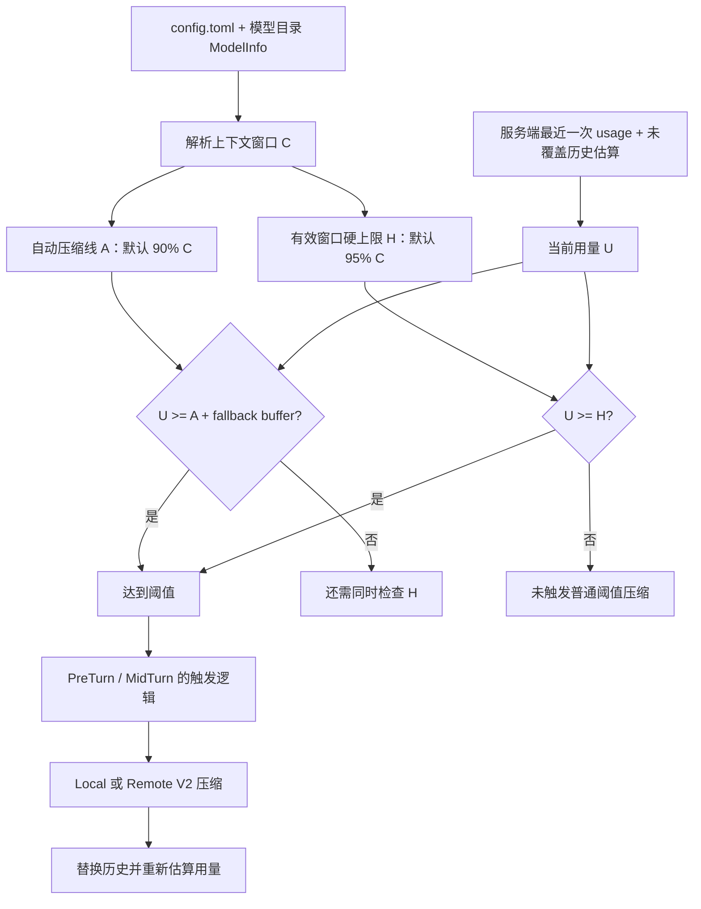
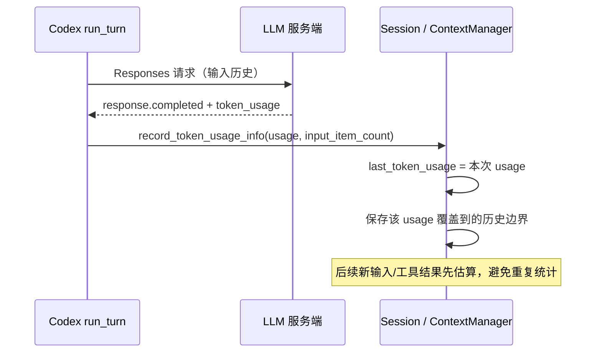
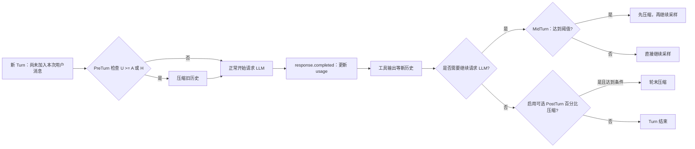

# Codex 源码解析：自动压缩阈值如何配置，以及上下文 Token 使用量如何计算

> **研究版本**：OpenAI 官方仓库 `openai/codex`，固定提交 [`e787cf7024fa66e4ec26c6c2ba9c122e045dedb9`](https://github.com/openai/codex/tree/e787cf7024fa66e4ec26c6c2ba9c122e045dedb9)。  
> **研究范围**：正常的“达到 token 阈值 → 触发上下文压缩”路径；包括配置、模型默认值、服务端 usage、客户端增量估算、文字/图片/工具输出、触发点和压缩后重新计数。涉及 `body_after_prefix` 与 TokenBudget 的分支会明确标出。  
> **源码行号**：以下全部基于上述固定提交，而**不是实时 `main`**。所有数字示例均为说明公式的假设值，不声称任何具体线上模型就是该值。

## 先给结论：五句话理解

1. **默认压缩阈值是模型上下文窗口 `C` 的 90%**：`A = floor(C × 0.90)`；如果你自定义 `model_auto_compact_token_limit`，常规 `total` 模式会取两者较小值。
2. **另有独立硬上限**：`H = floor(C × effective_context_window_percent / 100)`，模型百分比字段默认 **95%**。触及 `A`（可能加 TokenBudget buffer）或 `H` 中任一条件，都视为达到限制。
3. **当前使用量不等于逐轮调用费用之和**。Codex 主要使用最近一次有效模型请求返回的 `usage.total_tokens`，加上**自该 usage 覆盖边界之后新增的历史项估算值**；必要时再补算早期未包含的加密 reasoning。
4. **增量估算是粗略的“可见内容字节数 ÷ 4”**，并针对图片、加密 reasoning、工具调用/结果等类型使用专门规则；它**不是**对全部 JSONL 做 tokenizer 精确计数。
5. 压缩成功后，Codex 将新有效历史替换旧历史，调用 `recompute_token_usage()` 重新计算**新窗口的估算基线**，之后继续用服务端 usage + 增量估算的方式跟踪。

---

## 1. 总体图：配置 → 统计 → 比较 → 压缩



> 图中 `A + fallback buffer` 只有配置了对应的 TokenBudget fallback 时才可能与 `A` 不同；**普通场景 buffer = 0**。这是“正常阈值”主线，不包含后台压缩候选已就绪、手动 `/compact` 等其他触发原因。

### 配套图片

> 本 `.md` 中的 Mermaid 流程图可直接在支持 Mermaid 的 Markdown 阅读器中渲染；配套的高清 PNG/SVG 图在随附 ZIP 中。

---

## 2. 阈值从哪里配置？怎样计算？

### 第一步：用户配置文件的字段

主要字段在 `~/.codex/config.toml`（Windows 常见路径是 `%USERPROFILE%\.codex\config.toml`）。示例：

```toml
# 可选；覆盖模型目录提供的上下文窗口，并受 max_context_window 限制
# model_context_window = 128000

# 可选；自定义自动压缩 token 阈值
model_auto_compact_token_limit = 80000

# 默认 total；另一实验/特定场景为 body_after_prefix
model_auto_compact_token_limit_scope = "total"

# 默认 0，表示不启用额外的轮末百分比压缩
model_post_turn_compact_threshold_percent = 0
```

- `model_context_window`：配置模型窗口大小；可选。
- `model_auto_compact_token_limit`：**压缩线**；可选。未配置时，采用模型目录的阈值或按窗口推导。
- `model_auto_compact_token_limit_scope`：决定是统计**全部有效上下文**（默认 `total`），还是只统计新窗口前缀之后的增长（`body_after_prefix`）。
- `model_post_turn_compact_threshold_percent`：仅控制**可选轮末提前压缩**，默认 0，不是正常 MidTurn/PreTurn 的 90% 阈值。

**源码：**[配置字段 `config_toml.rs:188–202`](https://github.com/openai/codex/blob/e787cf7024fa66e4ec26c6c2ba9c122e045dedb9/codex-rs/config/src/config_toml.rs#L188-L202)；[scope 默认 `total`：`config_types.rs:42–55`](https://github.com/openai/codex/blob/e787cf7024fa66e4ec26c6c2ba9c122e045dedb9/codex-rs/protocol/src/config_types.rs#L42-L55)；[Config 加载默认值 `config/mod.rs:4777–4785`](https://github.com/openai/codex/blob/e787cf7024fa66e4ec26c6c2ba9c122e045dedb9/codex-rs/core/src/config/mod.rs#L4777-L4785)。

### 第二步：把配置覆盖到模型信息 `ModelInfo`

```python
# Rust: models-manager/src/model_info.rs:19-31

def with_config_overrides(model, config):
    if config.model_context_window is not None:
        model.context_window = min(
            config.model_context_window,
            model.max_context_window if model.max_context_window is not None else config.model_context_window,
        )
    if config.model_auto_compact_token_limit is not None:
        model.auto_compact_token_limit_value = config.model_auto_compact_token_limit
    return model
```

这一步**只是更新模型元数据字段**。之后调用模型方法，仍会计算自动压缩阈值的上限。源码：[models-manager/src/model_info.rs:19–31](https://github.com/openai/codex/blob/e787cf7024fa66e4ec26c6c2ba9c122e045dedb9/codex-rs/models-manager/src/model_info.rs#L19-L31)。

### 第三步：模型窗口 `C`、压缩阈值 `A`、有效硬上限 `H`

**常规 `total` 模式：**

$
C = \begin{cases}
\text{context\_window}, & \text{若有值}\\
\text{max\_context\_window}, & \text{否则若有值}
\end{cases}
$

$
A = \begin{cases}
\min(\text{configured\_auto\_limit}, \lfloor 0.90 C \rfloor), & C\text{ 有值且配置了阈值}\\
\lfloor 0.90 C \rfloor, & C\text{ 有值且未配置阈值}\\
\text{configured\_auto\_limit}, & C\text{ 无值且配置了阈值}\\
\text{None}, & \text{两者均不可得}
\end{cases}
$

$
H = \left\lfloor C \times \frac{\text{effective\_context\_window\_percent}}{100} \right\rfloor
\quad(\text{默认 } 95\%)
$

忠实的 Python 伪代码：

```python
# Rust: protocol/src/openai_models.rs:573-596
class ModelInfo:
    def resolved_context_window(self):
        return self.context_window if self.context_window is not None else self.max_context_window

    def auto_compact_token_limit(self):
        C = self.resolved_context_window()
        context_limit = C * 9 // 10 if C is not None else None
        configured = self.auto_compact_token_limit_value
        if context_limit is not None:
            return min(configured, context_limit) if configured is not None else context_limit
        return configured

    def usable_context_window(self):
        C = self.resolved_context_window()
        return C * self.effective_context_window_percent // 100 if C is not None else None
```

**源码：**[openai_models.rs:573–596](https://github.com/openai/codex/blob/e787cf7024fa66e4ec26c6c2ba9c122e045dedb9/codex-rs/protocol/src/openai_models.rs#L573-L596)、[默认 95%：`openai_models.rs:414–416`](https://github.com/openai/codex/blob/e787cf7024fa66e4ec26c6c2ba9c122e045dedb9/codex-rs/protocol/src/openai_models.rs#L414-L416)。

**示例（假设 C=100,000）：**

| 自定义压缩阈值 | 算出的 `A` | 算出的 `H`（默认 95%） | 说明 |
|---|---:|---:|---|
| 未配置 | 90,000 | 95,000 | 默认 90% 压缩 |
| `70,000` | 70,000 | 95,000 | 允许更早压缩 |
| `120,000` | 90,000 | 95,000 | 常规 total 模式下被 90% 上限截住 |

**不要混淆：90% 是自动压缩默认线，95% 是独立有效窗口硬上限，并不意味着每次要等到 95% 才压缩。** 两者的实际百分比来自模型元数据，95% 是代码默认值，不保证所有模型都使用同一个实际配置。

### 第四步：比较阈值

```python
# Rust: core/src/session/context_window.rs:56-120
active_context_tokens = await sess.get_total_token_usage()  # 记为 U

if config.model_auto_compact_token_limit_scope == "total":
    scope_tokens = U
    scope_limit = model_info.auto_compact_token_limit()
else:  # body_after_prefix：见 §7
    window = await sess.auto_compact_window_snapshot()
    baseline = window.prefill_input_tokens if window.prefill_input_tokens is not None else U
    scope_tokens = U - baseline
    scope_limit = (config.model_auto_compact_token_limit
                   if config.model_auto_compact_token_limit is not None
                   else model_info.auto_compact_token_limit())

C = model_info.resolved_context_window()
H = C * model_info.effective_context_window_percent // 100 if C is not None else None

# TokenBudget 特殊模式可提供 fallback buffer；普通场景为 0
buffer = (config.token_budget.fallback_buffer_tokens()
          if config.token_budget is not None else 0)

buffered_limit = scope_limit + buffer if scope_limit is not None else None
full_limit_reached = H is not None and U >= H
token_limit_reached = (
    (buffered_limit is not None and scope_tokens >= buffered_limit)
    or full_limit_reached
)
```

源码：[context_window.rs:56–120](https://github.com/openai/codex/blob/e787cf7024fa66e4ec26c6c2ba9c122e045dedb9/codex-rs/core/src/session/context_window.rs#L56-L120)。

**因此普通情况下可以简写为：**

```python
should_compact_due_to_tokens = (U >= A) or (U >= H)
```

这里的 `U` 怎样算？这是下一节最关键的内容。

---

## 3. “当前上下文使用量”到底怎么算？

### 第一步：分清两个名字很像的数

`TokenUsageInfo` 中有：

| 字段 | 意义 | 是否直接拿来与阈值比较 |
|---|---|---|
| `total_token_usage` | **本会话累计消耗**的各次采样 usage，会叠加 | **否** |
| `last_token_usage` | **最近一次有效服务端 usage**（或刚压缩完成的本地重估基线） | **是，取其中 `total_tokens`** |
| `last_usage_includes_reasoning` | 最近 usage 是否已经包括之前保留的 reasoning | 决定是否需要补算早期 reasoning |
| `model_context_window` | 当前 token 信息关联的模型窗口 | 上下文相关元数据，不是当前使用量 |

模型返回的 usage 一般包含 `input_tokens`、`output_tokens`、`reasoning_output_tokens`、`total_tokens` 等字段。`cached_input_tokens` 是缓存输入量的统计字段，**并不是计算上下文占用时额外加一次**。`last_token_usage.total_tokens` 是服务端最近一次响应给出的总 usage，而 `total_token_usage.total_tokens` 是多个响应累计后的消耗；两者不能混用。

源码：[TokenUsage / TokenUsageInfo 定义与累计更新 `protocol.rs:2603–2674`](https://github.com/openai/codex/blob/e787cf7024fa66e4ec26c6c2ba9c122e045dedb9/codex-rs/protocol/src/protocol.rs#L2603-L2674)。

### 第二步：服务端完成一次正常采样，记录 usage



`ResponseEvent::Completed` 中，Codex 将 `token_usage` 传给 `record_token_usage_info`；普通 Sampling 分支写入 `history.update_token_info(...)`，最终 `TokenUsageInfo::new_or_append(...)` 会：

- 把这次 usage **累加到** `total_token_usage`（累计消耗）；
- 把这次 usage **覆盖到** `last_token_usage`（最新上下文计数基础）；
- 设置 `last_usage_includes_reasoning`；
- 记录本次 usage 已经覆盖到历史中的哪个位置。

源码：[turn.rs:3746–3805](https://github.com/openai/codex/blob/e787cf7024fa66e4ec26c6c2ba9c122e045dedb9/codex-rs/core/src/session/turn.rs#L3746-L3805)；[session/mod.rs:5909–5956](https://github.com/openai/codex/blob/e787cf7024fa66e4ec26c6c2ba9c122e045dedb9/codex-rs/core/src/session/mod.rs#L5909-L5956)；[history.rs:1129–1155](https://github.com/openai/codex/blob/e787cf7024fa66e4ec26c6c2ba9c122e045dedb9/codex-rs/core/src/context_manager/history.rs#L1129-L1155)。

> **重要例外**：采样被重试、仅需计费的 `SpendingOnly` 分支会更新累计消耗，但不会把那次失败/重试的 usage 错当作新的**有效上下文**计数基线；这是为了避免用未被接受的输出错误覆盖有效历史。见 `session/mod.rs:5938–5955`。

### 第三步：记录“usage 覆盖到哪条消息”的边界

真实源码：

```python
# 对应 ContextManager.update_token_info(...)
covered_item_count = max(last_model_output_item_count or 0, input_item_count)
last_server_reported_usage_item_count = covered_item_count
last_token_usage = usage
```

含义：服务端的 usage 已经覆盖模型输入，以及此次成功响应中的已记录模型输出。后面有新历史项时，**只估算尚未被覆盖的尾部**，否则会重复计算。

例如：

```text
历史序列：
[User1, Assistant1, ToolCall1, ToolResult1, User2, Assistant2] | [ToolResult2, User3]
                               ↑                       ↑
                  最近一次有效 usage 的覆盖范围       尚未包含的新内容

最后 2 个 item 才进入尾部估算；前面的模型输入/输出由服务端 usage 代表。
```

**边界的具体取法**：`max(last_model_output_item_count, input_item_count)`，不是简单的“上一个 Turn 的最后一个用户输入”。官方测试还验证了：空的成功响应覆盖其输入消息；新增用户消息、工具结果会被计入未覆盖尾部。见 [history.rs:1129–1155](https://github.com/openai/codex/blob/e787cf7024fa66e4ec26c6c2ba9c122e045dedb9/codex-rs/core/src/context_manager/history.rs#L1129-L1155) 与 [history_tests.rs:1375–1447](https://github.com/openai/codex/blob/e787cf7024fa66e4ec26c6c2ba9c122e045dedb9/codex-rs/core/src/context_manager/history_tests.rs#L1375-L1447)。

### 第四步：实际计算当前占用 `get_total_token_usage()`

**这是整个流程最重要的函数：**

```python
# Rust: core/src/context_manager/history.rs:1169-1228

def get_total_token_usage(history):
    info = history.token_info
    last_tokens = info.last_token_usage.total_tokens if info is not None else 0

    # 上次 usage 覆盖边界之后，新记录的各个 history item
    unreported_tokens = sum(
        estimate_item_token_count_with_audio(item, history.file_audio_durations)
        for item in history.items[history.last_server_reported_usage_item_count:]
    )

    # 如果服务端 usage 已经涵盖被保留的历史 reasoning，则不需要重复加
    if info is not None and info.last_usage_includes_reasoning is True:
        return last_tokens + unreported_tokens

    # 否则，补估计「指定早期范围」内的旧加密 reasoning
    return (last_tokens
            + get_non_last_reasoning_items_tokens(history)
            + unreported_tokens)
```

数学上：

$
U = \texttt{last\_usage.total\_tokens}
    + \texttt{unreported\_tail\_estimate}
        + \begin{cases}
        0 & \text{usage 已包括旧 reasoning}\\
        \texttt{earlier\_encrypted\_reasoning\_estimate} & \text{否则}
      \end{cases}
        $

`get_non_last_reasoning_items_tokens()` **不是全历史所有 reasoning 的估算总和**：只扫描到最后一个真实的用户/指令 Turn 边界之前、并且在 usage 覆盖边界之前的加密 reasoning 项。源码里对范围有明确限制。

来源：[history.rs:1169–1228](https://github.com/openai/codex/blob/e787cf7024fa66e4ec26c6c2ba9c122e045dedb9/codex-rs/core/src/context_manager/history.rs#L1169-L1228)。

> 本节的“最新 usage + 增量尾部 + 旧 reasoning”配套 PNG 示意图见 ZIP 文件 `figures/02_usage_accounting.png`。

**示意例子：** 最近一次服务端报告 `last_token_usage.total_tokens = 84,000`；后面又新加入 6,000 估算 tokens 的工具/用户内容；且由于 `includes_reasoning=False`，符合条件的早期加密 reasoning 估算为 2,000。则：

```text
U = 84,000 + 6,000 + 2,000 = 92,000
A = 90,000
H = 95,000

U >= A，所以触发普通阈值条件。
```

即使 `total_token_usage.total_tokens`（全部 API 请求累计消耗）可能早已是数十万或更多，**本次判断仍使用上述 `U`，不是累计账单总数。**

### 第五步：如果还没有服务端 usage 怎么办？

`last_tokens` 初值为 `0`，尾部估算从尚未覆盖的历史位置开始；如果此前没有有效 usage，新增记录会由 `estimated_tokens_since_last_usage()` 估算。这是**粗估兜底**，不是“完全无法统计”。

还要注意，`estimate_token_count_with_base_instructions()` 是另一个**全量历史重估**函数，用于压缩完成等场合，它会额外考虑尚未记录进历史的 base instructions；这与平常的“最近一次 usage + 尾部增量”不同。源码：[history.rs:881–915](https://github.com/openai/codex/blob/e787cf7024fa66e4ec26c6c2ba9c122e045dedb9/codex-rs/core/src/context_manager/history.rs#L881-L915)。

---

## 4. 没有服务端计数的历史项怎样估算 Token？

### 4.1 总原则：估计模型可见内容字节数，再 `/ 4` 向上取整

```python
# Rust: core/src/context_manager/history.rs:1362-1378

def estimate_item_token_count(item, audio_durations):
    bytes_count = estimate_response_item_model_visible_bytes(item, audio_durations)
    return (bytes_count + 3) // 4  # 对正整数的近似公式
```

它取的主要是**模型可见内容**，而非把 JSONL 里整条记录的结构、时间戳、所有 meta 字段和 base64 图片字节逐字计算进去。

**文本计算示例：**

| 内容 | UTF-8 字节数 | 估算 tokens |
|---|---:|---:|
| 100 个 ASCII 字符 | 100 B | 25 |
| 100 个常见中文字符（每个约 3 B） | 约 300 B | 约 75 |
| 20,000 B 工具文字结果 | 20,000 B | 5,000 |

此处不是说中文**真实 tokenizer** 一定每 4 字节 1 token；只是还原 Codex 这个粗略估算器的行为。

源码：[utils/string/src/truncate.rs:94–106](https://github.com/openai/codex/blob/e787cf7024fa66e4ec26c6c2ba9c122e045dedb9/codex-rs/utils/string/src/truncate.rs#L94-L106)、[history.rs:1362–1378](https://github.com/openai/codex/blob/e787cf7024fa66e4ec26c6c2ba9c122e045dedb9/codex-rs/core/src/context_manager/history.rs#L1362-L1378)。

### 4.2 不同 `ResponseItem` 的估算方法

| 历史 Item | Codex 统计的主要内容 | 备注 |
|---|---|---|
| `Message(user/assistant)` | 各 `InputText` / `OutputText` 文本字节 + 其媒体估算 | 不按整个 Message JSON 长度 |
| `FunctionCall`、`CustomToolCall` | 名称、namespace、参数或 input 字符串字节 | 工具调用参数是原始文本/JSON 文本内容 |
| `FunctionCallOutput` / `CustomToolCallOutput` | 输出正文（文本/图片/音频/加密项）+ 相关调用字段 | 工具输出很大时会抬高后续阈值用量 |
| `Reasoning(encrypted_content)` | 特殊加密内容估算 | 不是 base64 字符串长度直接 `/4` |
| 纯文本、无加密内容的 Reasoning | 0（此重放计数路径） | 明确不按推理明文全文计算 |
| `Compaction` 加密项 | `estimate_compaction_content_length()` | 主要和 Remote V2 有关 |
| `AdditionalTools` / 搜索请求等 | 对属于模型输入的 JSON 参数做序列化后估算 | 非整个外部 Rollout 对象 |
| `ConfigurationUpdate`、`CompactionTrigger` 等 | 0（此估算函数） | 不代表 API 真实全额开销必为零 |

源码：[history.rs:1403–1521](https://github.com/openai/codex/blob/e787cf7024fa66e4ec26c6c2ba9c122e045dedb9/codex-rs/core/src/context_manager/history.rs#L1403-L1521)、[history.rs:1639–1664](https://github.com/openai/codex/blob/e787cf7024fa66e4ec26c6c2ba9c122e045dedb9/codex-rs/core/src/context_manager/history.rs#L1639-L1664)。

#### 旧加密 Reasoning 的估计

源码对加密 reasoning 的字符串长度使用如下思路：

```python
encoded_len = len(encrypted_content.encode("utf-8"))
estimated_bytes = max(0, (encoded_len * 3) // 4 - 650)
estimated_tokens = (estimated_bytes + 3) // 4
```

这只是近似；尤其不能把它理解为完整的模型真实思维 token 数量。来源：[history.rs:1350–1360](https://github.com/openai/codex/blob/e787cf7024fa66e4ec26c6c2ba9c122e045dedb9/codex-rs/core/src/context_manager/history.rs#L1350-L1360)。

### 4.3 图片如何计数？（重点）

Codex **不是把图片 data URL 的整个 base64 字符串按文字算 token**。它针对图片类型估算：

**普通 detail（不是 `original`）：**

```python
RESIZED_IMAGE_BYTES_ESTIMATE = 7373
image_tokens = (7373 + 3) // 4  # 1844 tokens 左右
```

这适用于该估算器中非 original detail 的 inline/file 图片引用。它是 Codex 的常数，不等于所有后端模型实际图像 token 花费。

**`detail="original"`：**

- 如果是可解析的 inline base64 图片，Codex 读取图片**宽高**：`patches = ceil(width/32) × ceil(height/32)`；最多算 10,000 patches，近似为相同数量的 tokens。
- 如果只有 `file_id` 而没有直接可读的图片尺寸，保守地用 10,000 patches。
- 如果 inline 图片尺寸解析失败，则回退到固定估算 7,373 B ≈ 1,844 tokens。

假设 `original` 图片大小为 `1024 × 768`：

```text
patch_width  = ceil(1024 / 32) = 32
patch_height = ceil( 768 / 32) = 24
estimated image tokens = 32 × 24 = 768
```

| 图片形式 | 示例估算 |
|---|---:|
| 普通图片 detail | ≈ 1,844 tokens |
| inline `original`，1024×768 | 768 tokens |
| inline `original`，4096×4096 | min(16,384, 10,000) = 10,000 |
| file 引用的 `original` | 10,000 |

相关源码：[history.rs:1380–1400](https://github.com/openai/codex/blob/e787cf7024fa66e4ec26c6c2ba9c122e045dedb9/codex-rs/core/src/context_manager/history.rs#L1380-L1400)、[history.rs:1534–1625](https://github.com/openai/codex/blob/e787cf7024fa66e4ec26c6c2ba9c122e045dedb9/codex-rs/core/src/context_manager/history.rs#L1534-L1625)。工具输出携带图片时，也是通过对应的图片内容类型进入估算器，见 [history.rs:1639–1664](https://github.com/openai/codex/blob/e787cf7024fa66e4ec26c6c2ba9c122e045dedb9/codex-rs/core/src/context_manager/history.rs#L1639-L1664)。

> **限定**：以上是历史 token 的客户端估算规则；不代表发送前图像预处理、实际 API 图像计费和所有模型输入上限都恰好如此。Codex 源码本身把这个估算称为 **coarse lower bound**（粗略下界）。

---

## 5. 到底在哪个时刻比较阈值并触发？



> PreTurn / MidTurn / PostTurn 的配套 PNG 示意图见 ZIP 文件 `figures/03_check_points.png`。

**PreTurn**：[`turn.rs:1751–1780`](https://github.com/openai/codex/blob/e787cf7024fa66e4ec26c6c2ba9c122e045dedb9/codex-rs/core/src/session/turn.rs#L1751-L1780) 调用 `context_window_token_status()`，如果 `token_limit_reached` 为真就进入 `run_auto_compact()`（后台压缩结果就绪也可触发）。**注意：此时新用户消息和新上下文尚未加入计数。** 源码专门留了 TODO，希望将来对待加入内容也提前估算，见 [`turn.rs:266–282`](https://github.com/openai/codex/blob/e787cf7024fa66e4ec26c6c2ba9c122e045dedb9/codex-rs/core/src/session/turn.rs#L266-L282)。

**MidTurn**：[`turn.rs:742–853`](https://github.com/openai/codex/blob/e787cf7024fa66e4ec26c6c2ba9c122e045dedb9/codex-rs/core/src/session/turn.rs#L742-L853) 在本轮采样后的 continuation 检查 token 状态；只有需要后续 LLM 请求（`needs_follow_up`）且满足压缩条件，才走该分支执行压缩并继续 Agent Loop。它能覆盖本轮内新工具输出增长引发的上下文风险。

**PostTurn（可选）**：[`turn.rs:930–956`](https://github.com/openai/codex/blob/e787cf7024fa66e4ec26c6c2ba9c122e045dedb9/codex-rs/core/src/session/turn.rs#L930-L956) 要求开启自动摘要、`model_post_turn_compact_threshold_percent > 0`、无新待处理输入、未取消等；具体百分比判定针对 `H`（即有效窗口上限）：

```python
post_turn_due = (
    percent > 0 and
    (token_limit_reached or (H is not None and U * 100 >= H * percent))
)
```

来源：[context_window.rs:114–120](https://github.com/openai/codex/blob/e787cf7024fa66e4ec26c6c2ba9c122e045dedb9/codex-rs/core/src/session/context_window.rs#L114-L120)。

> 手动 `/compact`、模型切换不兼容、后台压缩候选已就绪，以及 TokenBudget 的主动新窗口请求也可能触发压缩，但它们不属于这里研究的“正常 token 阈值比较”主线。

---

## 6. 压缩完成之后，新的上下文使用量怎样更新？

这里**不是**继续使用旧窗口的 `last_token_usage.total_tokens`，因为旧历史已经替换了。

Local 的路径：

```text
LLM 生成摘要
  → 构建新历史（保留项 + 摘要 + 重新注入当前上下文）
  → replace_compacted_history(...)
  → recompute_token_usage(...)
  → 下一次正常采样
```

`recompute_token_usage()` 使用新历史的 `estimate_token_count_with_base_instructions()` 做**全量粗估**，然后：

```python
# core/src/session/mod.rs:5991-6033 的思路
estimated_total_tokens = history.estimate_token_count_with_base_instructions(base_instructions)

info.last_token_usage = TokenUsage(
    input_tokens=0,
    cached_input_tokens=0,
    cache_write_input_tokens=0,
    output_tokens=0,
    reasoning_output_tokens=0,
    total_tokens=max(estimated_total_tokens, 0),
)
info.last_usage_includes_reasoning = True  # 新基线已经涵盖留在历史中的 reasoning
history.set_token_info_with_boundary(info, len(history.items))
```

这既建立了新窗口的用量基线，也设置尾部边界为新历史末尾，避免再次将摘要和保留项当作“新加入尾部”重复计算。之后若又加入新消息，会继续走“最后有效 usage + 新尾部”的机制；得到新的服务端 usage 后基线也会更新。

源码：[compact.rs:444–473](https://github.com/openai/codex/blob/e787cf7024fa66e4ec26c6c2ba9c122e045dedb9/codex-rs/core/src/compact.rs#L444-L473)、[session/mod.rs:5991–6033](https://github.com/openai/codex/blob/e787cf7024fa66e4ec26c6c2ba9c122e045dedb9/codex-rs/core/src/session/mod.rs#L5991-L6033)、[history.rs:892–915](https://github.com/openai/codex/blob/e787cf7024fa66e4ec26c6c2ba9c122e045dedb9/codex-rs/core/src/context_manager/history.rs#L892-L915)。

---

## 7. 进阶分支：`body_after_prefix` 不是正常默认模式

默认 `scope="total"` 是最值得先学的：拿**整个有效上下文 U**直接与阈值比较。

如果配置：

```toml
model_auto_compact_token_limit_scope = "body_after_prefix"
model_auto_compact_token_limit = 70000
```

算法变为：

```python
baseline = window.prefill_input_tokens or U  # 实际 Rust 使用 Option：0 是有效值
body_tokens = U - baseline

if body_tokens >= 70_000 or U >= H:
    # 满足普通阈值条件
    ...
```

- `baseline` 是**该上下文窗口的初始输入部分**，不是当前整个用户对话的起点；窗口刚建立时可能是估算值。
- 首次成功的正常服务端 usage 到来后，优先使用第一次响应的 `usage.input_tokens` 记录**服务端观察到的前缀基线**；本次响应的 `output_tokens` 是窗口增长部分，不应被减掉。
- 随后的服务端 usage 不会反复改写这一基线。
- `H` 始终基于**完整 U**检查，`body_after_prefix` 不绕过有效窗口硬上限。

举例：`baseline=40,000`，当前 `U=89,000`，则 `body_tokens=49,000`。即使 `U` 已接近普通 90k 线，只要 body 预算是 70k，且未触及 `H=95,000`，**该 scope 分支不会因为普通 body 阈值触发**。如果 `U=96,000`，则虽然 `body_tokens=56,000`，但触及 `H`，仍会触发。

**一个源码细节**：`body_after_prefix` 分支优先直接使用 `config.model_auto_compact_token_limit`，只有没配置时才回退到 `model_info.auto_compact_token_limit()`；因此不能把 `total` 模式的“总是先 clamp 到 90% C”原封不动套到此分支。两者都受独立 `H` 限制。

源码：[context_window.rs:63–89](https://github.com/openai/codex/blob/e787cf7024fa66e4ec26c6c2ba9c122e045dedb9/codex-rs/core/src/session/context_window.rs#L63-L89)、[auto_compact_window.rs:103–139](https://github.com/openai/codex/blob/e787cf7024fa66e4ec26c6c2ba9c122e045dedb9/codex-rs/core/src/state/auto_compact_window.rs#L103-L139)、[session/mod.rs:5924–5935](https://github.com/openai/codex/blob/e787cf7024fa66e4ec26c6c2ba9c122e045dedb9/codex-rs/core/src/session/mod.rs#L5924-L5935)。

---

## 8. 组合示例：从输入、工具输出，到跨越阈值

假设：

```toml
model_context_window = 100000
# model_auto_compact_token_limit 未显式设置
model_auto_compact_token_limit_scope = "total"
model_post_turn_compact_threshold_percent = 0
```

所以 `A=90,000`、`H=95,000`。

| 时间点 | 变化 | 计算中的当前 `U` | 是否达到普通阈值 |
|---|---|---:|---|
| Turn 开始前 | 最近有效 API usage 为 82,000，无其他增量 | 82,000 | 否 |
| LLM 完成一次采样 | API 新 usage 为 84,000，更新 `last_token_usage` 和覆盖边界 | 84,000 | 否 |
| Tool 1 返回文字 | 新增 12,000 B ≈ 3,000 tokens | 87,000 | 否 |
| Tool 2 返回更多数据 | 新增 16,000 B ≈ 4,000 tokens | 91,000 | **是** |
| 下一个正常 LLM 请求前 | Agent 还需继续执行，进入 MidTurn 检查 | 91,000 | **先压缩** |
| Local 压缩完成 | 新摘要 + 保留项 + 初始上下文重建，假设全量估算为 18,500 | 18,500 | 否 |
| 继续 LLM 采样 | 新的真实 usage 再次建立服务端计数 | 由新 usage 更新 | 后续继续检查 |

注意表中的工具输出字节估算，为简明起见未额外展开调用 ID 等字段；实际以 `estimate_item_token_count_with_audio()` 的完整规则为准。模型还可能在上述过程之外因服务端真正的上下文超限而报错；此处仅说明 Codex 在正常路径怎样**预防性触发压缩**。

---

## 9. 最小但忠实的 Python 总体伪代码

```python
from dataclasses import dataclass
from typing import Optional


@dataclass
class TokenUsage:
    input_tokens: int = 0
    output_tokens: int = 0
    total_tokens: int = 0


@dataclass
class TokenUsageInfo:
    total_token_usage: TokenUsage   # 累计采样消耗
    last_token_usage: TokenUsage    # 最近有效上下文计数
    last_usage_includes_reasoning: Optional[bool] = None


class ContextManager:
    def __init__(self):
        self.items = []
        self.token_info: Optional[TokenUsageInfo] = None
        self.last_model_output_item_count: Optional[int] = None
        self.last_server_reported_usage_item_count = 0
        self.file_audio_durations = {}  # 省略音频专用实现

    def update_token_info(self, usage, model_context_window,
                          includes_reasoning, input_item_count):
        # TokenUsageInfo::new_or_append：累计总花费，更新最新一次 usage
        if self.token_info is None:
            self.token_info = TokenUsageInfo(TokenUsage(), TokenUsage())
        self.token_info.total_token_usage.total_tokens += usage.total_tokens
        self.token_info.last_token_usage = usage
        self.token_info.last_usage_includes_reasoning = includes_reasoning

        covered_item_count = max(self.last_model_output_item_count or 0, input_item_count)
        self.last_server_reported_usage_item_count = covered_item_count

    def estimated_tokens_since_last_usage(self):
        return sum(
            estimate_item_token_count_with_audio(item, self.file_audio_durations)
            for item in self.items[self.last_server_reported_usage_item_count:]
        )

    def get_total_token_usage(self):
        info = self.token_info
        last_tokens = info.last_token_usage.total_tokens if info is not None else 0
        extra = self.estimated_tokens_since_last_usage()
        if info is not None and info.last_usage_includes_reasoning is True:
            return last_tokens + extra
        return last_tokens + self.get_non_last_reasoning_items_tokens() + extra

    def get_non_last_reasoning_items_tokens(self):
        # 参见 history.rs:1169-1193；遵循最后 user 边界及 usage 覆盖边界。
        # 这里保留调用点，不重新定义 Rust 的消息边界匹配器。
        ...


def context_window_token_status(sess, config, model_info):
    # 该函数在 Rust 里是 async，这里省略 await 语法仅突出计算顺序
    U = sess.history.get_total_token_usage()
    C = model_info.resolved_context_window()
    H = C * model_info.effective_context_window_percent // 100 if C is not None else None

    if config.model_auto_compact_token_limit_scope == "total":
        scope_tokens = U
        A = model_info.auto_compact_token_limit()
    else:
        prefill = sess.auto_compact_window_snapshot().prefill_input_tokens
        baseline = U if prefill is None else prefill
        scope_tokens = U - baseline
        A = (config.model_auto_compact_token_limit
             if config.model_auto_compact_token_limit is not None
             else model_info.auto_compact_token_limit())

    buffer = config.token_budget.fallback_buffer_tokens() if config.token_budget else 0
    reached = ((A is not None and scope_tokens >= A + buffer)
               or (H is not None and U >= H))
    return reached


# PreTurn：if await context_window_token_status(...): run_auto_compact(...)
# MidTurn：if needs_follow_up and await context_window_token_status(...): run_auto_compact(...)
# 完成压缩：replace_compacted_history(); recompute_token_usage()
```

> 伪代码尽量保持**原始源码的数据结构、判断顺序和功能分层**，但省略了 Rust 的饱和整数运算、`Option` 类型拆包、音频专用计算和异步锁。`estimate_item_token_count_with_audio` 的每个 match 分支见上文 §4 的源码链接；不是用一个简单 `len(json.dumps(item))/4` 代替。

---

## 10. 易混淆的地方（重点复核）

1. **90% ≠ 95%**：90% 是默认自动压缩阈值；95% 是默认可用上下文上限。默认情况下先撞到 90%。
2. **用户设 `model_auto_compact_token_limit` 并不保证立即精确按它执行**：`total` 模式下还受 `min(用户值, 90% C)` 截断；还存在独立 `H`，以及 TokenBudget buffer 的特例。
3. **不是每次从头遍历全部历史做 tokenizer**：正常判断是最近有效的 API usage + 增量历史估算 + 条件性旧 reasoning 估算。
4. **`total_token_usage` ≠ 当前上下文长度**：它是 API 消耗累加；比较阈值使用 `get_total_token_usage()` 返回值，而此函数内部使用的核心字段是 `last_token_usage.total_tokens`，名称很容易误导。
5. **历史 JSONL 字节长度 ≠ token 估算**：估算的是模型可见内容的类型化成本；图片不按 base64 全量计数。
6. **工具输出会增长下一次上下文**：即使工具输出不是用户消息，仍是历史 item，MidTurn 检查必须把它算进去。
7. **模型切换与当前生效模型的窗口有关**：本篇的 `C`/`A` 是由当前解析的 ModelInfo 得出；不同模型不能机械沿用同一个 90k 数字。
8. **压缩后基线必须重算**：新历史已经替换，不能继续拿旧窗口的服务端 usage 当当前占用。
9. **PreTurn 没有预估刚来的用户消息**：固定提交中写明 TODO，意味着特大用户消息仍可能在随后采样时才显现风险。
10. **估算只是防护近似**：服务端实际 token 化、工具定义、隐藏开销、媒体预处理与传输表示等可能不同；源码称估算为粗略下界，不能保证阈值绝不误差。

---

## 11. 源码位置速查（均是本篇实际核对过的固定提交）

| 主题 | 路径和行号 |
|---|---|
| TOML 配置字段 | [`config/src/config_toml.rs:188–202`](https://github.com/openai/codex/blob/e787cf7024fa66e4ec26c6c2ba9c122e045dedb9/codex-rs/config/src/config_toml.rs#L188-L202) |
| 配置装载默认值 | [`core/src/config/mod.rs:4777–4785`](https://github.com/openai/codex/blob/e787cf7024fa66e4ec26c6c2ba9c122e045dedb9/codex-rs/core/src/config/mod.rs#L4777-L4785) |
| `total` scope 默认 | [`protocol/src/config_types.rs:42–55`](https://github.com/openai/codex/blob/e787cf7024fa66e4ec26c6c2ba9c122e045dedb9/codex-rs/protocol/src/config_types.rs#L42-L55) |
| 配置覆盖模型元数据 | [`models-manager/src/model_info.rs:19–31`](https://github.com/openai/codex/blob/e787cf7024fa66e4ec26c6c2ba9c122e045dedb9/codex-rs/models-manager/src/model_info.rs#L19-L31) |
| 模型 90% 阈值算法 | [`protocol/src/openai_models.rs:573–596`](https://github.com/openai/codex/blob/e787cf7024fa66e4ec26c6c2ba9c122e045dedb9/codex-rs/protocol/src/openai_models.rs#L573-L596) |
| 模型有效窗口默认 95% | [`protocol/src/openai_models.rs:414–416`](https://github.com/openai/codex/blob/e787cf7024fa66e4ec26c6c2ba9c122e045dedb9/codex-rs/protocol/src/openai_models.rs#L414-L416) |
| **阈值计算核心** | [`core/src/session/context_window.rs:56–132`](https://github.com/openai/codex/blob/e787cf7024fa66e4ec26c6c2ba9c122e045dedb9/codex-rs/core/src/session/context_window.rs#L56-L132) |
| 服务端采样 Completed 收 usage | [`core/src/session/turn.rs:3746–3805`](https://github.com/openai/codex/blob/e787cf7024fa66e4ec26c6c2ba9c122e045dedb9/codex-rs/core/src/session/turn.rs#L3746-L3805) |
| usage 累计/最后一次区别 | [`protocol/src/protocol.rs:2603–2674`](https://github.com/openai/codex/blob/e787cf7024fa66e4ec26c6c2ba9c122e045dedb9/codex-rs/protocol/src/protocol.rs#L2603-L2674) |
| 记录 usage 覆盖边界 | [`core/src/context_manager/history.rs:1129–1155`](https://github.com/openai/codex/blob/e787cf7024fa66e4ec26c6c2ba9c122e045dedb9/codex-rs/core/src/context_manager/history.rs#L1129-L1155) |
| **当前上下文使用量核心** | [`core/src/context_manager/history.rs:1169–1228`](https://github.com/openai/codex/blob/e787cf7024fa66e4ec26c6c2ba9c122e045dedb9/codex-rs/core/src/context_manager/history.rs#L1169-L1228) |
| 整段历史重估 | [`core/src/context_manager/history.rs:881–915`](https://github.com/openai/codex/blob/e787cf7024fa66e4ec26c6c2ba9c122e045dedb9/codex-rs/core/src/context_manager/history.rs#L881-L915) |
| 文本字节/token 近似 | [`utils/string/src/truncate.rs:94–106`](https://github.com/openai/codex/blob/e787cf7024fa66e4ec26c6c2ba9c122e045dedb9/codex-rs/utils/string/src/truncate.rs#L94-L106) |
| item 估算和类型分支 | [`core/src/context_manager/history.rs:1350–1521`](https://github.com/openai/codex/blob/e787cf7024fa66e4ec26c6c2ba9c122e045dedb9/codex-rs/core/src/context_manager/history.rs#L1350-L1521) |
| 图片/工具图片估算 | [`core/src/context_manager/history.rs:1534–1664`](https://github.com/openai/codex/blob/e787cf7024fa66e4ec26c6c2ba9c122e045dedb9/codex-rs/core/src/context_manager/history.rs#L1534-L1664) |
| PreTurn 阈值检查 | [`core/src/session/turn.rs:1751–1780`](https://github.com/openai/codex/blob/e787cf7024fa66e4ec26c6c2ba9c122e045dedb9/codex-rs/core/src/session/turn.rs#L1751-L1780) |
| MidTurn 阈值检查 | [`core/src/session/turn.rs:742–853`](https://github.com/openai/codex/blob/e787cf7024fa66e4ec26c6c2ba9c122e045dedb9/codex-rs/core/src/session/turn.rs#L742-L853) |
| 可选 PostTurn 阈值 | [`core/src/session/turn.rs:930–956`](https://github.com/openai/codex/blob/e787cf7024fa66e4ec26c6c2ba9c122e045dedb9/codex-rs/core/src/session/turn.rs#L930-L956) |
| 重建压缩后 token 基线 | [`core/src/session/mod.rs:5991–6033`](https://github.com/openai/codex/blob/e787cf7024fa66e4ec26c6c2ba9c122e045dedb9/codex-rs/core/src/session/mod.rs#L5991-L6033) |
| BodyAfterPrefix 基线 | [`core/src/state/auto_compact_window.rs:103–139`](https://github.com/openai/codex/blob/e787cf7024fa66e4ec26c6c2ba9c122e045dedb9/codex-rs/core/src/state/auto_compact_window.rs#L103-L139) |
| 尾部估算/边界单测 | [`core/src/context_manager/history_tests.rs:1375–1447`](https://github.com/openai/codex/blob/e787cf7024fa66e4ec26c6c2ba9c122e045dedb9/codex-rs/core/src/context_manager/history_tests.rs#L1375-L1447) |

---

### 最终要记住的主干

```text
配置/模型目录
  ↓
C：模型上下文窗口
  ├─ A：自动压缩阈值（默认 90%）
  └─ H：有效上下文上限（默认 95%）

每次有效 LLM response.completed
  ↓
保存本次 usage.total_tokens + 已覆盖历史边界
  ↓
有新用户输入或工具输出 → 只估算未覆盖的历史尾部
  ↓
U = 最新服务端 usage + 尾部估算 + 必要的旧 reasoning 估算
  ↓
PreTurn / MidTurn 检查：U >= A（普通情况）或 U >= H
  ↓
自动压缩 → 新历史替换 → 全量估算新基线 → 继续
```

**一句话：Codex 不是“每次拿历史全文数 token，再对比 90%”。它的普通路径是“最新一次服务端真实 usage 为基准，加未覆盖增量的粗估，然后与模型派生阈值比较”。**
