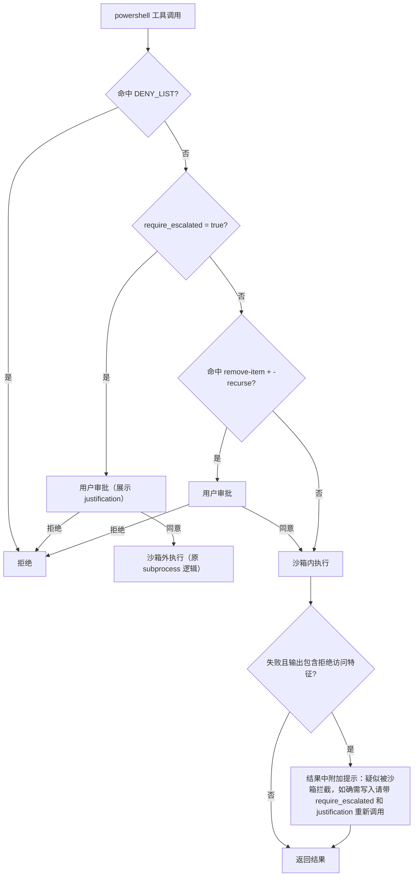

# PowerShell 沙箱设计（Windows 写受限令牌）

## 1. 背景与目标

现在 `powershell` 工具的安全检查只有三条：

1. 硬拒绝关键词（`DENY_LIST`）；
2. `workdir` 在允许目录外 → 需要审批；
3. 同时包含 `remove-item` 和 `-recurse` → 需要审批。

这三条检查的都是**命令文本**和**起始目录**，命令执行时实际会写哪些路径并不受限制。例如 workdir 在 cwd 内，执行 `Set-Content D:\其他项目\a.py 'x'`，不会触发任何审批。改用别名（`ri -r`、`del /s`）或 `-EncodedCommand` 也能轻松绕过关键词检查。

**目标**：让操作系统来保证 powershell 子进程**只能写** `cwd + allowed_dirs`（以下统称“可写根目录”），**读不受限**（参考 Codex 在 Windows 上的做法）。确实需要写到范围外时，模型显式申请，**用户审批通过后在沙箱外执行**这一条命令。

**不在本次范围内**：

- 读限制（powershell 仍然能读任意文件）；
- 网络隔离；
- stdio 类型的 MCP 子进程；
- read/write/edit/glob/read_images 这几个文件工具（它们本来就在进程内按路径审批，规则不变）。

## 2. 方案选择

| 方案 | 结论 |
|---|---|
| **写受限令牌** + 自定义 SID + 目录 ACL | ✅ 采用。不需要管理员权限，只影响写，读和兼容性基本不受影响 |
| AppContainer | ❌ 读写都会限制，工具链（uv、基础 Python 解释器、用户模块）需要逐个授权，兼容性成本高 |
| 低完整性级别（Low IL） | ❌ 需要把允许目录标成 Low，系统里其他低完整性进程（比如浏览器沙箱）也能写这些目录 |
| 专用本地用户 / Windows Sandbox / Docker | ❌ 需要管理员安装，或者太重 |

## 3. 原理

### 3.1 写受限令牌

Windows 访问检查对 **restricted token（受限令牌）** 会做两遍：一遍按普通 SID 列表检查，一遍按“限制 SID 列表”检查，**两遍都通过**才放行。

调用 `CreateRestrictedToken` 时带上 `WRITE_RESTRICTED` 标志，限制 SID 列表就**只在写访问时**参与检查：

- **读**：只检查普通 SID，和当前用户完全一样 → 读不受影响；
- **写**：还要求目标对象的 ACL 授权给了限制 SID 列表中的某个 SID → 只有我们授权过的目录才能写。

本方案给令牌设置的限制 SID 列表：

| SID | 作用 |
|---|---|
| **沙箱 SID** | 用 `DeriveCapabilitySidsFromName("miniAgentSandbox")` 派生的固定 capability SID（`S-1-15-3-...`）。同一个名字每次派生结果都相同，所以不需要另外保存 |
| Logon SID（当前登录会话的 SID） | 保证子进程能正常使用控制台和自己创建的内核对象 |
| Everyone（`S-1-1-0`） | 保证 `NUL` 这类授权给 Everyone 可写的设备能正常使用。副作用：本来就对 Everyone 开放写权限的目录在沙箱内也能写，可以接受 |

再叠加 `DISABLE_MAX_PRIVILEGE` 标志去掉特权，防止进程以管理员身份运行时用 SeBackup / SeRestore 这类特权绕过 ACL。

令牌的**默认 DACL**（子进程新建对象时使用的权限列表）要补上沙箱 SID 和 Logon SID。否则子进程新建的文件、管道等对象，它自己都写不了。

### 3.2 目录授权

给每个可写根目录加一条**可继承**的 ACE，授予沙箱 SID 修改权限：

```powershell
icacls "<目录>" /grant:r "*S-1-15-3-...:(OI)(CI)M"
```

- `(OI)(CI)`：继承给子文件和子目录，会自动传播到已有的子项；
- `/grant:r`：替换这个 SID 原有的显式授权，重复执行结果不变；
- 这条 ACE 只对带有沙箱 SID 的受限令牌生效，正常进程不受影响，所以**保留，不撤销**；
- 进程内用一个集合缓存已授权的目录，每个目录只调用一次 `icacls`；用线程锁保护，因为工具在线程池里执行。

> 手动清理：`icacls "<目录>" /remove "*S-1-15-3-..."`。实际 SID 会在首次授权时写入日志。

### 3.3 临时目录

很多程序会写 `%TEMP%`（`C:\Users\<用户>\AppData\Local\Temp`），但它不在授权范围内。处理方式：新建项目内目录 `PROJECT_ROOT/sandbox_tmp`，同样授权给沙箱 SID，并把子进程的 `TEMP` / `TMP` 环境变量指向它。这个目录加入 `.gitignore`。

### 3.4 进程启动

`subprocess` 不支持指定令牌，所以用 ctypes 调 Win32 API：

1. `OpenProcessToken` 打开当前进程令牌 → `CreateRestrictedToken` → `SetTokenInformation(TokenDefaultDacl)`；
2. `CreatePipe` 创建 stdout 和 stderr 管道。通过 `STARTUPINFOEX` + `PROC_THREAD_ATTRIBUTE_HANDLE_LIST` **只让子进程继承这两个写端**，避免多个会话并发启动子进程时句柄串到别的子进程，导致读端一直等不到 EOF；
3. `CreateProcessAsUserW` 启动 powershell。标志为 `CREATE_SUSPENDED | CREATE_UNICODE_ENVIRONMENT | EXTENDED_STARTUPINFO_PRESENT | CREATE_NO_WINDOW`；
4. 创建 **Job Object** 并设置 `KILL_ON_JOB_CLOSE`，把进程加入 Job 后再 `ResumeThread`；
5. 两个线程分别读 stdout 和 stderr（避免缓冲区写满卡死），主流程用 `WaitForSingleObject` 等待，超时时间沿用 `powershell_timeout`；
6. 不管是正常结束还是超时，最后都关闭 Job 句柄，**整个进程树一起结束**（现在 `subprocess.run` 超时只杀 powershell 本身）。

> 不需要管理员权限：`CreateProcessAsUserW` 使用当前进程令牌派生出的受限令牌时，不需要 `SeAssignPrimaryTokenPrivilege`。Chromium 的沙箱也是这么做的。

返回格式与现在保持一致：`{"exit_code", "stdout", "stderr"}`，超时时为 `{"error", "stdout", "stderr"}`。

## 4. 越权写的审批流程



### 4.1 工具参数（powershell schema 新增）

| 参数 | 类型 | 说明 |
|---|---|---|
| `require_escalated` | boolean，可选 | 为 true 时申请在沙箱外执行，需要用户审批 |
| `justification` | string，可选 | 申请沙箱外执行的理由，展示给用户 |

### 4.2 被沙箱拦截时：提示模型，不自动重试

沙箱内执行失败、且 stdout/stderr 中包含拒绝访问特征（`拒绝访问`、`Access to the path`、`Access is denied`、`UnauthorizedAccessException`）时，在返回的 JSON 里加一个 `sandbox_hint` 字段，同时记录 warning 日志。由**模型决定**是否带 `require_escalated` 重新调用。

这样处理的原因：审批需要用到 session 和 dispatcher，这些只在 `tool_guard` 那一层才有；工具函数内部不做审批，分层更清楚。模型带着理由主动申请，用户审批时信息也更完整。

### 4.3 tool_guard 规则调整

| 规则 | 调整 |
|---|---|
| `DENY_LIST` | 保留。修正 `("shutdown")` → `("shutdown",)`：现在它是字符串，`all()` 会逐个字符匹配，导致误拒 |
| 新增：`require_escalated` 为 true | 需要审批，审批提示里展示 justification |
| `powershell` 的 workdir 越界审批 | **去掉 powershell，只保留 glob**。沙箱已经限制了写，读本来就不限制，起始目录在哪里已经无关紧要 |
| `remove-item` + `-recurse` 审批 | 保留。沙箱只能挡住范围外，范围内整目录被删一样损失很大 |

`run_powershell` 只看 `require_escalated` 决定走哪个分支，自己不再做判断。审批一定在执行之前（`ToolManager.execute` 先调 `audit_tool_request`），所以参数为 true 时一定已经审批通过。

## 5. 配置

`config.yaml` 新增：

```yaml
# PowerShell 是否在写受限沙箱中执行；可写范围为当前工作目录 + allowed_dirs。
powershell_sandbox: true
```

- `Config` 增加 `powershell_sandbox: bool` 并校验类型；
- 设为 `false` 时 `run_powershell` 走原来的 `subprocess.run`，用于排查兼容性问题。`require_escalated` 参数仍然保留，审批照常进行。

系统提示词中加一句：

> PowerShell 在沙箱中执行：读取不受限，只能写入 {可写根目录}。确需写入其他位置时，设置 require_escalated=true 并填写 justification，经用户审批后在沙箱外执行。

## 6. 改动清单

| 文件 | 改动 |
|---|---|
| `src/security/sandbox.py`（新增） | 派生沙箱 SID、目录授权与缓存、受限令牌、带 Job 的进程启动和输出收集 |
| `src/tools/local_tools.py` | `run_powershell` 按配置和 `require_escalated` 选择沙箱或原逻辑；schema 新增两个参数；附加 `sandbox_hint` |
| `src/security/tool_guard.py` | 新增升级审批规则，调整 workdir 规则，修正 shutdown，审批提示带上 justification |
| `src/config.py`、`config.yaml` | 新增 `powershell_sandbox` |
| `src/system_prompt.py` | 补充沙箱说明 |
| `.gitignore` | 忽略 `sandbox_tmp/` |
| `README.md` | 项目结构中加入 `security/` 目录（README 现在缺这部分）和 `sandbox.py` |

不新增依赖（只用 ctypes）。

## 7. 已知限制

- **读不受限**：powershell 可以读取 `.ssh`、`.env` 等任意文件。这是“只限制写”带来的取舍；
- **网络不受限**：沙箱内可以联网，也就可能把读到的内容发出去；
- **可写根目录内部不做细分**：沙箱可以改项目里的 `config.yaml`、`.env`、`.git`，以及 `src/security/` 本身。以后可以给这些路径加上针对沙箱 SID 的拒绝 ACE，实现只读子路径（Codex 对 `.git` 就是这样处理的）；
- **需要写用户目录的工具在沙箱内会失败**（比如 `uv sync` 要写 `%LOCALAPPDATA%\uv\cache`，`pip install --user`）：返回 `sandbox_hint` 后由模型申请沙箱外执行；
- **首次授权大目录可能较慢**：ACE 继承会传播到整棵目录树（比如带 `.venv` 的项目），首次可能需要几秒到几十秒；
- **命令里启动的后台进程**会在 powershell 退出时随 Job 一起结束。

## 8. 验收方式（开发完成后手动验证）

| 场景 | 预期 |
|---|---|
| `Set-Content .\sandbox_test.txt 'x'`（cwd 内） | 成功 |
| `Set-Content D:\其他目录\a.txt 'x'`（范围外） | 失败，结果带 `sandbox_hint` |
| 同上命令，带 `require_escalated=true` 和理由 | 弹审批，同意后成功，拒绝后不执行 |
| `Get-Content $env:USERPROFILE\.gitconfig` | 成功（读不受限） |
| 写 `allowed_dirs` 中配置的目录 | 成功 |
| `Start-Sleep 999` 超过超时时间 | 超时返回，进程树被结束 |
| `git status`、`.venv\Scripts\python -c "print(1)"` | 正常 |
| `powershell_sandbox: false` | 行为和改造前一致 |
